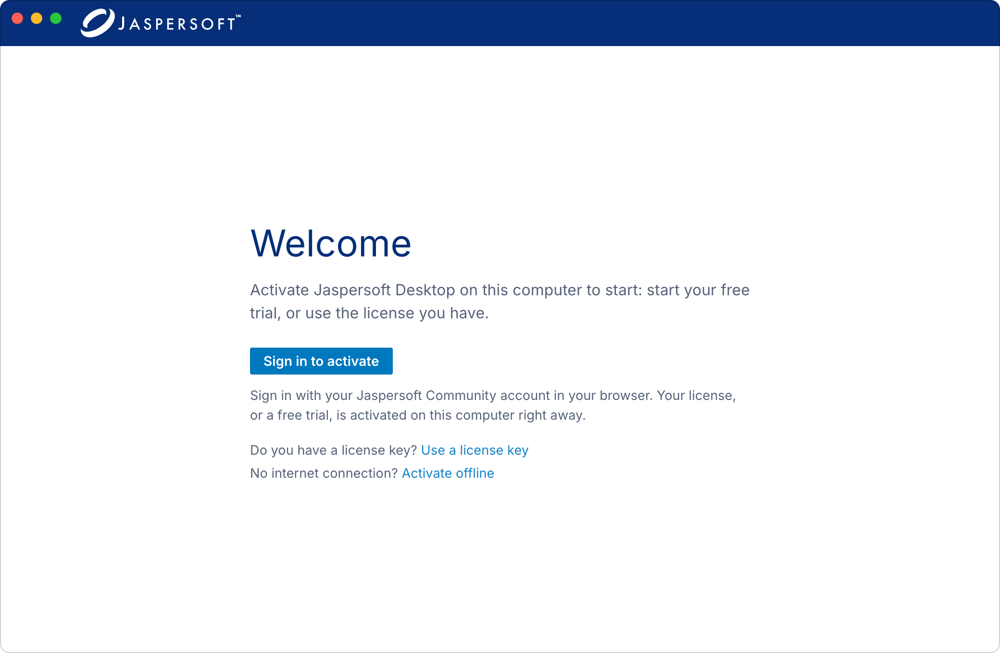
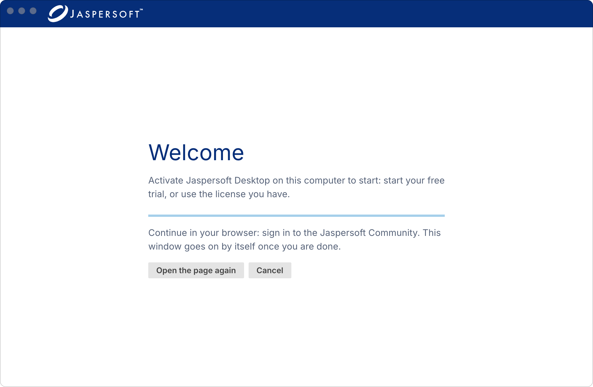
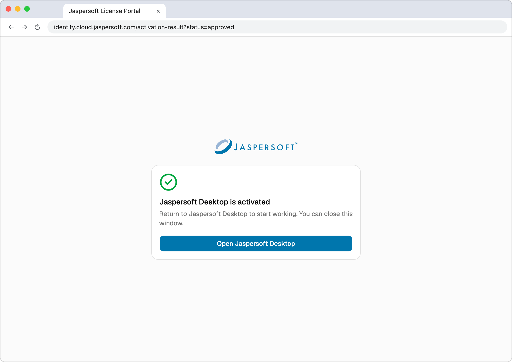
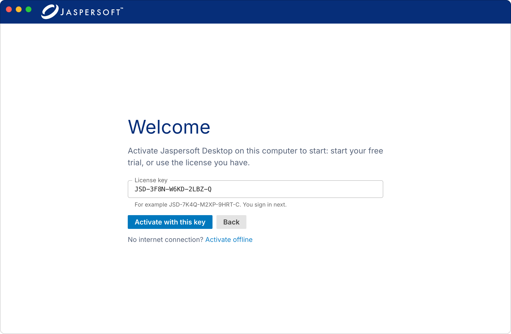
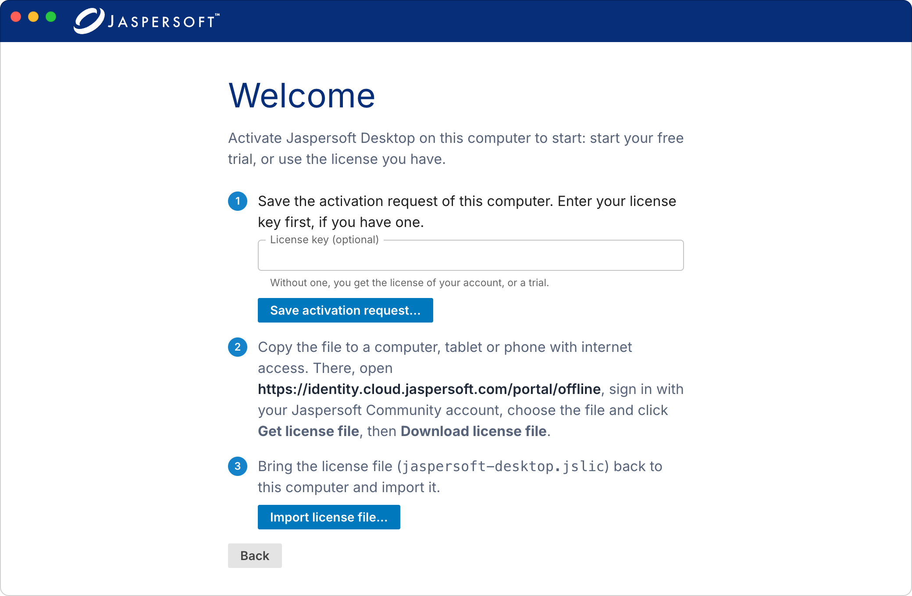
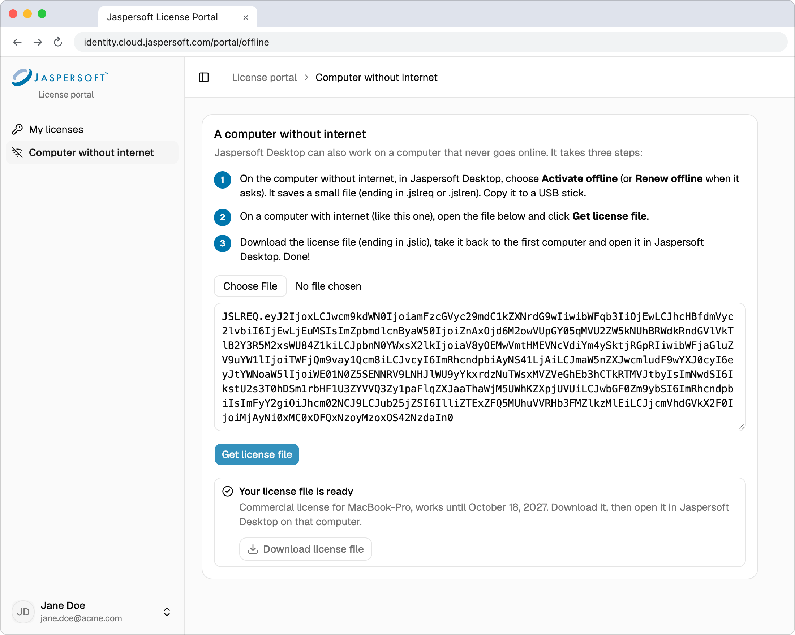
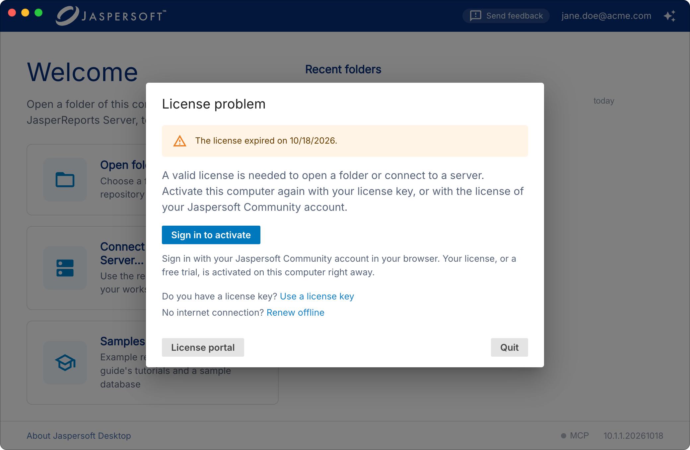
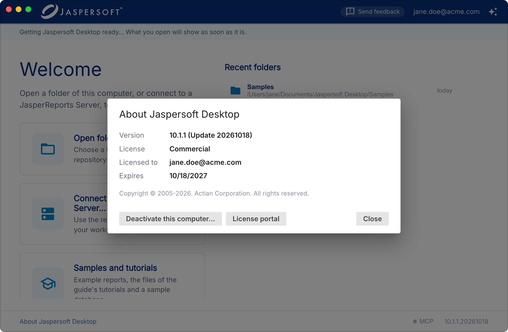
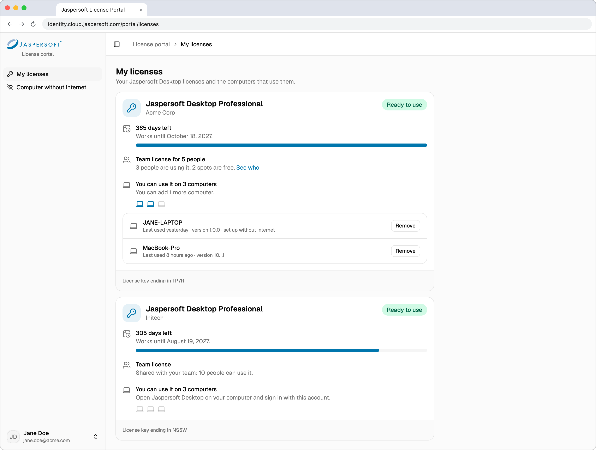
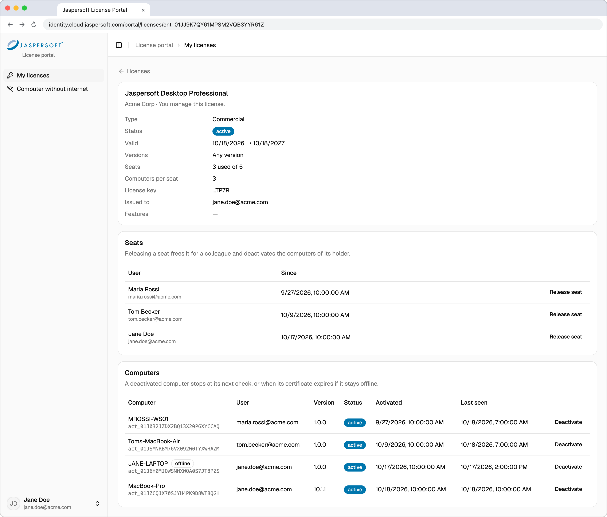

# Activating Jaspersoft Desktop

This guide explains how to activate Jaspersoft Desktop, keep your license up to date, and see
your licenses and computers in the License portal.

## Before you start

You need a **Jaspersoft Community account** (community.jaspersoft.com). You can sign in with your
community password or with **Sign in with HCL software**. Your license is linked to this account.

A few terms used in this guide:

| Term | What it means |
| --- | --- |
| **License** | Your right to use Jaspersoft Desktop: a free trial, an extended trial or a commercial license. |
| **License key** | A code like `JSD-7K4Q-M2XP-9HRT-C` that comes with a purchased license. You can share it with your team. Uppercase or lowercase, spaces and dashes do not matter. |
| **Single user license** | A license for one person: you. Every trial is a single user license. |
| **Team license** | A license for several people, for example 5 people at the same company. Each person who uses it takes one of its places, called a **seat**. |
| **Computer** | You can use your license on a few computers (usually 3), for example a desktop and a laptop. The License portal shows how many more you can add. |
| **License file** | A `.jslic` file stored on your computer. Jaspersoft Desktop checks it at every start, so it works without an internet connection. |
| **License manager** | The person a team license was issued to. They can see who uses it and free a seat for someone else. |

## First activation (with internet connection)

1. Start Jaspersoft Desktop. The first time, it asks you to activate it.
2. Click **Sign in to activate**. Your web browser opens.
3. Sign in with your community account. If you are already signed in, you will not see the sign-in page.
4. The browser shows **Jaspersoft Desktop is activated**. Jaspersoft Desktop goes on by itself; you
   can close the browser window, or click **Open Jaspersoft Desktop** to switch back to the app.

While Jaspersoft Desktop waits for the browser, you can click **Open the page again** (if you closed
the browser tab) or **Cancel**.

That is all. Jaspersoft Desktop picks the right license for you:

- if a license was issued to you (see below), it uses that license;
- otherwise, if this computer is already running your trial, it keeps the trial;
- otherwise it starts a **free 30-day trial** of Jaspersoft Desktop.

"Issued to you" means that when your company bought the license, the email address of your
community account was registered with it, as its license manager or as one of its users (for
example, every address at `@acme.com`). Nothing is read from your mailbox: the email address of the
account you sign in with is compared with the one on the license.

Your browser may ask "Open Jaspersoft Desktop?" when you click the button. Allow it (you can choose to
always allow it).

### Activating with a license key

If you received a license key:

1. Below the **Sign in to activate** button, next to **Do you have a license key?**, click **Use a
   license key**.
2. Type or paste the key in **License key**.
3. Click **Activate with this key**, then sign in in the browser as above.

Jaspersoft Desktop then uses **that** license. If it is a team license, you take one of its seats.
This computer is added to the computers of your license. If the key cannot be used (for example, all seats are taken), you will see why;
no trial is started instead.

Some license keys can only be used by specific people: by the person the license was issued to, or
by everyone with an email address at the company's domain (for example `@acme.com`). If you see
"This license key is restricted to other users", sign in with the community account the license is
meant for.

### If something goes wrong

The browser page and Jaspersoft Desktop show the reason. The most common ones:

| Message | What to do |
| --- | --- |
| Your free trial has ended. | Buy a license, or ask your company for a license key. |
| A free trial was already used on this computer. | Each computer gets one free trial, and every account gets one. Sign in with the account you used before, or use a license key. |
| Your license is already active on the maximum number of computers. | Deactivate a computer you no longer use: from that computer (see [Moving to a new computer](#moving-to-a-new-computer)) or in the License portal (see [Removing a computer](#removing-a-computer)). Then try again. |
| All seats of your license are in use. | Every seat of the team license is taken. Ask your license manager to free one. |
| This license key does not exist. | Check the key for typos. |
| This license has expired / has been revoked / is suspended. | Contact your license manager or Jaspersoft support. |
| This activation link has expired. | You took more than 20 minutes to sign in. Start again from Jaspersoft Desktop. |

## First activation (without internet connection)

Use this when the computer where you run Jaspersoft Desktop has no internet access, or a proxy or
firewall blocks it. You exchange two small files with the License portal from **any other device
with internet access** (another computer, a tablet, a phone). Your license is still linked to your
community account.

1. In Jaspersoft Desktop, below **Sign in to activate**, next to **No internet connection?**, click
   **Activate offline**. (Jaspersoft Desktop also offers it when it cannot reach the license
   server.) If you have a license key, enter it.
2. Click **Save activation request…** and save the **request file** (`.jslreq`). Copy it to a device
   with internet access, for example with a USB stick or by email. Jaspersoft Desktop shows the
   address of the License portal's page to open there.
3. On that device, open the License portal and sign in with your community account.
4. Go to **Computer without internet**, open the request file (or paste its content), and click
   **Get license file**.
5. The portal shows **Your license file is ready**. Click **Download license file**. You get
   `jaspersoft-desktop.jslic`.
6. Copy the license file back to the offline computer. In Jaspersoft Desktop, choose
   **Import license file** and select it.

The same rules apply as for online activation: a trial, the license issued to your email, or the
license of your key. If the request cannot be accepted, the portal shows the reason (see the table
[above](#if-something-goes-wrong)).

If the computer gets internet access later, Jaspersoft Desktop switches to automatic updates by
itself. You do not need to activate again.

## Updating the license

### Automatic updates (computers with internet access)

When it is online, Jaspersoft Desktop checks your license once a day, in the background. This is how
it receives, **without any action from you**:

- **renewals and extensions**: when your license is renewed or your trial is extended, the new
  end date reaches Jaspersoft Desktop within a day. This works even after the license has expired:
  just start Jaspersoft Desktop again.
- **removed computers**: a computer removed in the License portal stops using the license at its
  next check.

From 30 days before your license ends, the home screen shows how many days are left ("Your trial
ends in 12 days"). If the license ends, or can no longer be used on this computer, Jaspersoft Desktop
shows the **License problem** dialog: you can activate again from there (with your account or a
license key), open the **License portal**, or quit.

### The About dialog

The **About** dialog shows the license this computer uses: its type (**License**), the account it is
**Licensed to**, when it **Expires**, and whether it is **Valid**. From there you can also open the
**License portal** and **Deactivate this computer…**.

Open it from the bar at the foot of the window — the **About Jaspersoft Desktop** link, on the home
screen and in an open workspace alike — or from the menu: on macOS **Jaspersoft Desktop → About
Jaspersoft Desktop**, on Windows and Linux **Help → About Jaspersoft Desktop**. Deactivating from a
workspace brings you back to the home screen, which asks for an activation.

### Switching from a trial to a purchased license

When you receive a license key during a trial:

1. Open the [About dialog](#the-about-dialog) and click **Deactivate this computer…**, then
   **Deactivate**. This ends the trial on this computer and brings back the activation screen.
2. Click **Use a license key**, enter the key, click **Activate with this key** and sign in.

If the license was issued to the email address of your community account (see
[above](#first-activation-with-internet-connection)), you do not even need the key: after step 1,
click **Sign in to activate** and the license is used instead of the trial.

**Trial with one account, company license with another.** For example, you started the trial with a
personal community account (`jane@gmail.com`), and your company's license is for `@acme.com`
addresses. Deactivate the computer as above, enter the key, and when the browser opens, sign in
with your **company** community account. If the browser signs you in automatically with your personal account, sign out of the
License portal (and of the Jaspersoft Community site) first, then start again from Jaspersoft
Desktop. Licenses restricted to specific people show "This license key is restricted to other
users" when you sign in with another account.

### Renewing offline

A computer without internet access cannot receive renewals by itself. From 30 days before the end
date (and after it), Jaspersoft Desktop offers **Renew offline**: in the **About** dialog, and in the
**License problem** dialog once the license has ended.

1. Choose **Renew offline**, click **Save renewal request…** and save the renewal request file
   (`.jslren`).
2. On a device with internet access, open it in the License portal under **Computer without
   internet** and click **Get license file**.
3. Download the new `jaspersoft-desktop.jslic` and import it in Jaspersoft Desktop with
   **Import license file**.

Only the person who activated the computer can renew it.

### A new version of Jaspersoft Desktop

Your license does not depend on the version of Jaspersoft Desktop you run. Updating the app, to a
new major version included, asks nothing of you: your license goes on working, and a trial you are
in runs until its end date. You are not asked to activate again.

### Moving to a new computer

On the old computer, open the [About dialog](#the-about-dialog), click **Deactivate this
computer…**, then **Deactivate**. Then activate Jaspersoft Desktop on the new one. Your license stays the same;
only the computer changes.

If you no longer have the old computer (replaced, broken, lost), remove it in the License portal
instead: see [Removing a computer](#removing-a-computer).

## The License portal

Open the License portal at `https://identity.cloud.jaspersoft.com/portal`
and sign in with your community account, or click **License portal** in Jaspersoft Desktop's
[About dialog](#the-about-dialog).

The portal has two pages, in the menu on the left: **My licenses** and **Computer without
internet**.

### My licenses

Each of your licenses is shown as a card. Licenses you can use come first; licenses that have ended
are listed at the bottom, under **Licenses that have ended**.

A card tells you, from top to bottom:

- **What it is**: **Free trial**, **Extended trial**, or the name of the license you bought and, for
  a company license, the company name.
- **Whether it works**, in the colored label at the top right:

  | Label | What it means |
  | --- | --- |
  | **Ready to use** | The license works. |
  | **Not started yet** | The license starts on a later date, shown on the card. |
  | **Paused** | The license is suspended. Contact your license manager or Jaspersoft support. |
  | **Ended** | The end date has passed. |
  | **Cancelled** | The license was revoked. |

- **How long it lasts**: how many days are left (for example **23 days left**) and the date it
  works until. The bar below empties as time goes by, and turns amber in the last 7 days.
- **Who can use it**: **Single user license** (only you), or **Team license** (see
  [Team licenses](#team-licenses)).
- **Your computers**: on how many computers you can use it, how many more you can add, and the
  list of computers that use it (see below).
- At the bottom, the last characters of the license key, if the license has one.

If you have no license yet, the page explains how to start your free trial: open Jaspersoft
Desktop and sign in with the same account.

### Your computers

Each card shows **You can use it on 3 computers** (the number depends on the license), with one
laptop icon per computer: the colored ones are in use. Below it, the card tells you how many more
computers you can add. When all of them are in use, remove one you no longer need before adding a
new one.

For each computer you see its name, when it was **last used**, its Jaspersoft Desktop version, and
**set up without internet** if it was activated offline. If two computers have the same name, the
date each one was added tells them apart.

A computer marked **On hold: we saw this license on two computers at once** used a copy of the
same activation, for example after cloning a disk or a virtual machine. It does not count toward
your computers. Remove it, then activate Jaspersoft Desktop again on the computer that needs it.

#### Removing a computer

Click **Remove** next to a computer you no longer use, have replaced or have lost, then confirm.
Jaspersoft Desktop on that computer stops using the license at its next daily check (a computer
that stays offline keeps working until its license file expires), and you can use the license on
another computer. You can add the removed computer back later by activating Jaspersoft Desktop on
it again.

### Team licenses

**How people get a seat.** Share the license key with your colleagues. Each person who activates
Jaspersoft Desktop with the key takes a free seat, linked to their community account. A second
computer of the same person does not take a second seat. When all seats are taken, the next person
sees "All seats of your license are in use".

**What everyone sees.** The card says **Team license** and how many people can use it. Each person
sees and removes only their own computers.

**What the license manager sees.** The card says, for example, **Team license for 5 people**, how
many people are using it and how many seats are free. Click **See who** to open the license page:

- the details of the license: validity dates, seats used, computers per seat, who it was
  issued to, and its features;
- **Seats**: who holds a seat and since when. **Release seat** frees the seat for someone else and
  deactivates all the computers of that person. Use it when someone leaves the team or no longer
  needs Jaspersoft Desktop.
- **Computers**: every computer that uses the license, and whose it is. **Deactivate** frees that
  computer, while its owner keeps their seat.

To add seats or extend a license, contact Jaspersoft sales.

### Computer without internet

Where you open the request files of computers without internet access and download their license
files, in three steps shown on the page. See
[First activation (without internet connection)](#first-activation-without-internet-connection)
and [Renewing offline](#renewing-offline).

## Frequently asked questions

**Do I need internet access to use Jaspersoft Desktop?**
Only to activate it (or use offline activation). Afterwards it works offline; it checks the license
online once a day when it can.

**I reinstalled my computer. Do I lose my activation?**
Activate again. If Jaspersoft Desktop counts it as a new computer and you reach the computer
limit, remove the old entry in the License portal (see [Removing a computer](#removing-a-computer)).

**Can I use my license at home and at work?**
Yes, on as many computers as the License portal shows on your license card (**You can use it on
3 computers**, for example).

**Who is my license manager?**
The person your company's license was issued to. If you are the license manager, the card of the team
license shows **See who**, and the license page shows your email as **Issued to**. Otherwise, ask
the person who gave you the license key.
