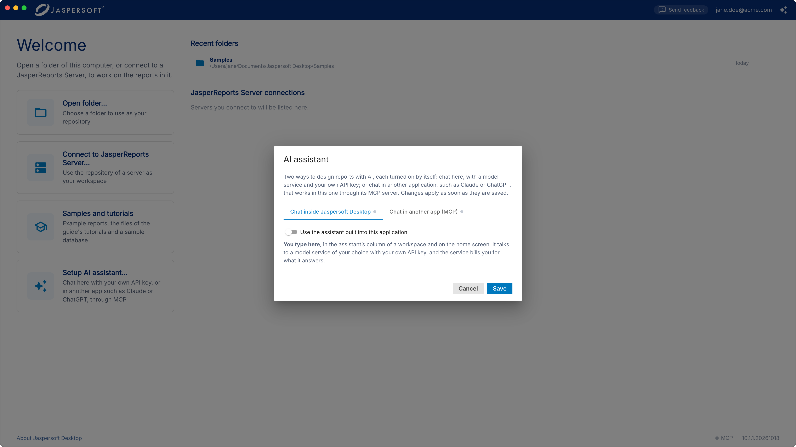
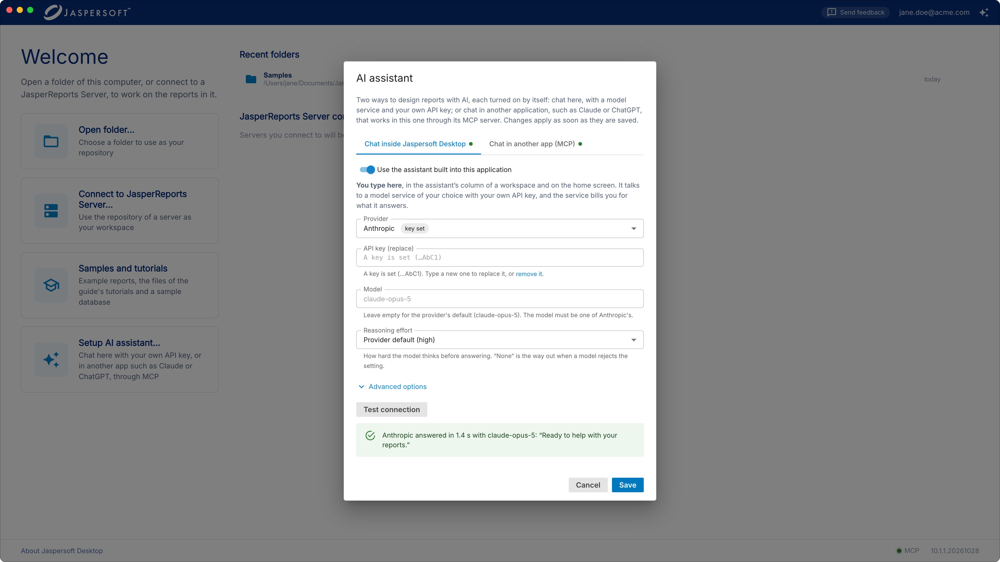
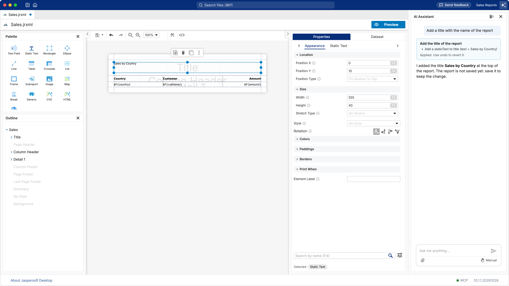
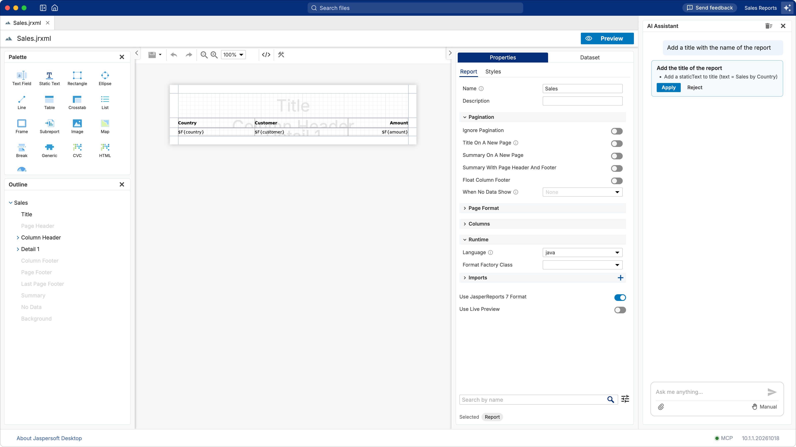
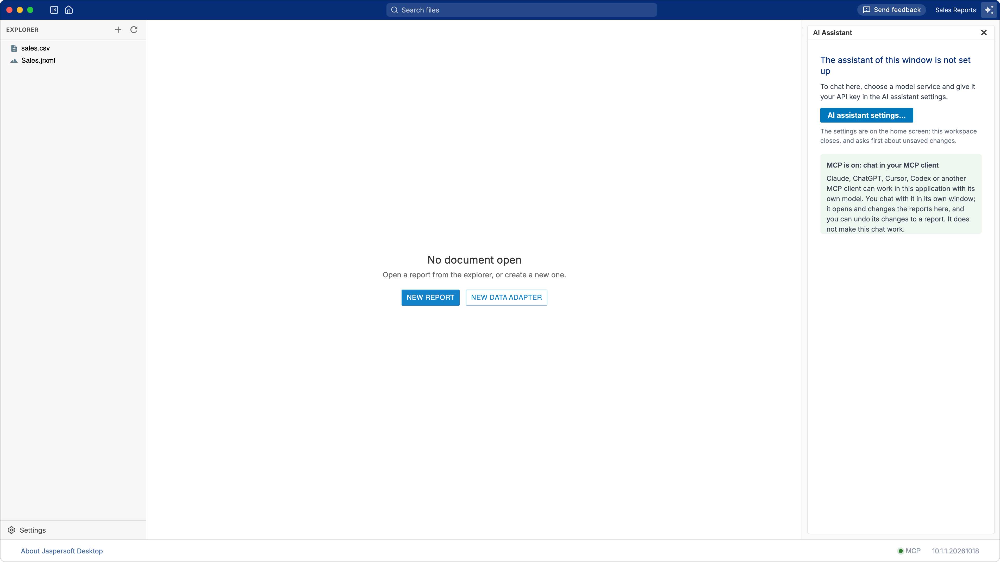
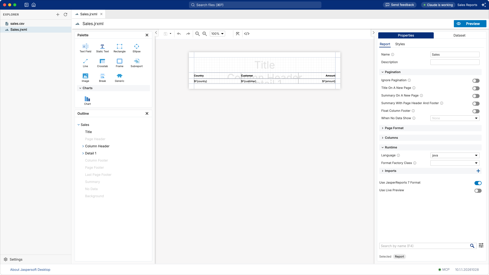
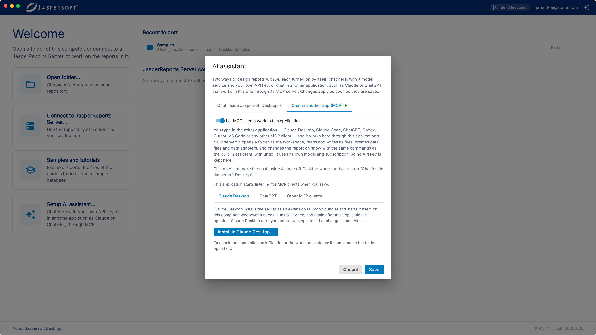
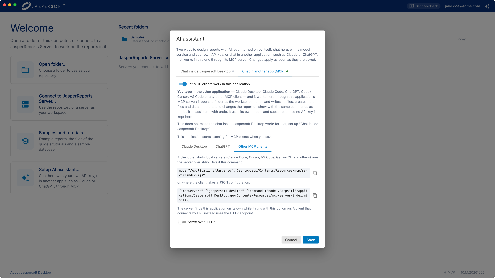

# Designing reports with AI

Jaspersoft Desktop can design reports with AI in two ways. This chapter explains the difference,
how to set up each one, and how to connect the AI tools you may already use (Claude, ChatGPT, Codex,
Cursor, VS Code and others).

## Two ways, and the difference between them

| | Chat inside Jaspersoft Desktop | Chat in another app (MCP) |
| --- | --- | --- |
| **Where you type** | In Jaspersoft Desktop: the AI Assistant column of a workspace, or the home screen | In the other application: Claude Desktop, Claude Code, ChatGPT, Codex, Cursor, VS Code… |
| **Which AI model answers** | The model service you choose (Anthropic, OpenAI, Google Gemini, DeepSeek), with your own API key, or a model on your own computer (Ollama) | The other application's own model |
| **Who pays** | The model service bills your API key for each question; nothing, with Ollama | Your subscription to the other application |
| **What it can do** | Change the report on show, create reports and data adapters, read and write the files of the workspace | The same: it uses the same commands, and its changes to a report can be undone the same way |
| **What you need** | An API key from a model service, or Ollama | The other application, and Jaspersoft Desktop running |

**Turning on the MCP server does not make the chat inside Jaspersoft Desktop work.** MCP lets
another application, with its own model, work *in* Jaspersoft Desktop: you chat in that
application, and you see its changes in Jaspersoft Desktop as they happen. To chat inside Jaspersoft
Desktop, you need a model service and an API key (see
[Chatting inside Jaspersoft Desktop](#chatting-inside-jaspersoft-desktop)).

You can use either way, or both. Both are set up in the **AI assistant** settings: on the home
screen, click **Set up AI Assistant…**.



The MCP server is a feature of Jaspersoft Desktop only.

## Chatting inside Jaspersoft Desktop

### What you need

An **API key** from one of these model services:

| Service | Where to get a key |
| --- | --- |
| **Anthropic** (Claude models) | console.anthropic.com, under API keys |
| **OpenAI** (GPT models) | platform.openai.com, under API keys |
| **Google Gemini** | aistudio.google.com, under Get API key; or Vertex AI with Google Cloud credentials |
| **DeepSeek** | platform.deepseek.com, under API keys |
| **Ollama** (a model on your own computer) | No key: see [A fully private setup with Ollama](#a-fully-private-setup-with-ollama) |

An API key is not the same as a subscription to the service's chat (Claude Pro, ChatGPT Plus…).
The service bills an API key by use, separately. If you already pay for a chat subscription and do
not want a second bill, use that application through MCP instead (see
[Working from another app (MCP)](#working-from-another-app-mcp)).

### Setting it up

1. On the home screen, click **Set up AI Assistant…**.
2. On the **Chat inside Jaspersoft Desktop** tab, turn on **Use the assistant built into this
    application**.
3. Choose the **Provider**.
4. Paste your **API key**.
5. Leave **Model** empty to use the provider's default model, or type the name of another model of
    that provider. The field suggests a few.
6. Click **Test connection**. Jaspersoft Desktop asks the provider a short question with these
    settings, and shows the answer, or what went wrong.
7. Click **Save**. The change applies at once; nothing needs restarting.



The API key is stored on your computer, encrypted by the operating system, and sent only to the
provider, with each question. It is never shown again: the dialog shows only its last characters.
To replace it, type a new one; to remove it, click **remove it** under the field.

**Reasoning effort** sets how hard the model thinks before answering. More effort gives better
answers to hard questions, and takes longer and costs more. If a model rejects the setting, choose
**None**.

#### Advanced options

| Option | When to change it |
| --- | --- |
| **API URL** | To go through a gateway, Azure OpenAI, or another service that speaks the same API as the provider. |
| **API** (OpenAI, DeepSeek) | **Chat Completions** for services that are compatible with OpenAI; only OpenAI has the **Responses** API. |
| **Vertex AI** (Google Gemini) | To use Gemini through Google Cloud, with a project and a service account key file instead of an API key. |
| **Attachments** | Whether questions may carry images and pages of PDF files. A screenshot of a preview shows real data: turn images off if that data must not leave your computer. |
| **Max output tokens**, **Request timeout** | For very long answers, or a slow service. |

### A fully private setup with Ollama

With [Ollama](https://ollama.com), the model runs on your computer. Your questions, your reports and
their data never leave it, and there is nothing to pay. In exchange, answers are slower, and a
model small enough for a laptop makes more mistakes than the large services do.

What you need:

- **Ollama**, installed from ollama.com.
- **A model that can use tools**: the assistant changes reports by calling tools, and a model that
    cannot gives answers but changes nothing. On ollama.com, such models carry the **tools** label;
    `gpt-oss:20b` and `qwen3` are good starting points.
- **Enough memory**: about 16 GB of RAM (or of video memory) for a model of 20 billion parameters,
    more for larger ones.

Use a model that runs on your computer. Models whose name ends in `-cloud` run on Ollama's servers,
and are not private.

1. Download the model. In a terminal:

    ```
    ollama pull gpt-oss:20b
    ```

2. **Give the model a longer context.** The assistant sends long instructions and the list of its
    tools with every question, and they do not fit in Ollama's default context of 4,096 tokens (the
    default on computers with less than 24 GB of video memory). In the Ollama app, open
    **Settings** and set **Context length** to at least 32k. If you start Ollama from a terminal
    instead, start it with:

    ```
    OLLAMA_CONTEXT_LENGTH=32768 ollama serve
    ```

3. In Jaspersoft Desktop, open the AI assistant settings and, on the **Chat inside Jaspersoft
    Desktop** tab, set:

    | Setting | Value |
    | --- | --- |
    | **Provider** | OpenAI (Ollama speaks the same API) |
    | **API key** | Any text, for example `ollama`. Ollama does not check it, but a provider without a key counts as not set up. |
    | **Model** | The model's name as `ollama list` shows it, for example `gpt-oss:20b` |
    | **Reasoning effort** | **None**, unless you know the model takes the setting |
    | **Advanced options › API URL** | `http://localhost:11434/v1` |
    | **Advanced options › API** | Chat Completions |
    | **Advanced options › Request timeout** | 600 seconds: the first answer waits for the model to load |
    | **Advanced options › Attachments** | Turn off images, unless the model can read them |

4. Click **Test connection**, then **Save**. The test result says "OpenAI answered…": that is the
    API it used; the answer came from your model.

Ollama must be running while you use the assistant. If the assistant answers but never changes the
report, the model cannot use tools or its context is too short: try another model, or a longer
context.

### Using the assistant

Open a workspace, then click the **AI Assistant** button at the right of the title bar (or choose
**View › AI Assistant**, **Ctrl+Shift+A**, on macOS **⌘⇧A**). Its column opens at the right of the
documents.



Ask in your own words, for example "add a title with the name of the report", "group the rows by
country" or "make a report from sales.csv". The assistant knows the open tabs and the files of the
workspace, not only the report on show. You can attach an image (a sketch, a screenshot of a
report to imitate) or a data file (CSV, JSON, Excel).

Before it changes a report, the assistant shows what it is about to do and waits for you:



- In **Manual** mode (the default), each change waits for **Apply** or **Reject**.
- In **Edit automatically** mode, changes to the report on show are made without asking. Each change
    is a single undo step, so **Edit › Undo** takes it back.

Writing or replacing a file of the workspace always asks first, in both modes.

The assistant changes the report in the editor. It does not save it: save it yourself when you are
happy with the result, as with any change.

### The assistant on the home screen

The home screen has an assistant too: click the **AI Assistant** button at its top right. It can
open a folder or a server for you and pass your request on, for example "open my Reports folder and
create a sales report from sales.csv". The workspace opens and its assistant takes the request up.

### If the assistant is not set up

If you open the assistant's column before setting up a model service, the column says so, with
a button to the settings. If the MCP server is on, it also reminds you that MCP does not make this
chat work, and that you chat in your MCP client instead.



**AI assistant settings…** closes the workspace (it asks first about unsaved changes) and opens the
settings on the home screen. When you open the workspace again, it is as you left it.

## Working from another app (MCP)

The **Model Context Protocol** (MCP) is a standard way for AI applications to use tools. Jaspersoft
Desktop comes with an MCP server: an AI application that supports MCP can open a folder in
Jaspersoft Desktop, read and write its files, create data files and data adapters, and change the
report on show, with the same commands as the built-in assistant.

Jaspersoft Desktop must be running while you work this way: the AI application works in it, and
you see the changes as they happen. While it works, the title bar says so:



### Turning the MCP server on

1. On the home screen, click **Set up AI Assistant…**.
2. Open the **Chat in another app (MCP)** tab.
3. Turn on **Let MCP clients work in this application**.
4. Click **Save**.



The **MCP** dot in the bar at the bottom of the window — on the home screen or in a workspace — is
green while the server is listening. Click it to see its details.

Then set up your AI application, as described below. To check the connection, ask it for "the
workspace status of Jaspersoft Desktop": it should name the folder open in Jaspersoft Desktop, or
say that none is open.

### Claude Desktop

1. On the **Chat in another app (MCP)** tab, under **Claude Desktop**, click **Install in Claude
    Desktop…**.
2. Claude Desktop opens and asks whether to install the **Jaspersoft Desktop** extension. Install it.

Claude Desktop starts the extension itself when it needs it. Install it again after Jaspersoft
Desktop is updated. Claude Desktop asks you before it runs a tool that changes something.

### ChatGPT

ChatGPT does not start servers on your computer: it reaches out from OpenAI's servers to an
address on the internet. So Jaspersoft Desktop serves the MCP server over HTTP, and a tunnel makes
it reachable.

1. On the **ChatGPT** tab, turn on **Serve over HTTP** and click **Save**. Open the dialog again to
    see the address of the endpoint, `http://127.0.0.1:18089/mcp/…`.
2. Start a tunnel to that port, for example `ngrok http 18089`, and note the public address it gives
    you.
3. In ChatGPT, open **Settings**, turn on **Developer mode**, and add a connector. Its URL is the
    public address of the tunnel followed by the path of the endpoint, from `/mcp/` to the end. No
    authentication.
4. Start a chat with the connector enabled.

**The address contains a secret, and it is the only thing that protects the tunnel:** whoever has it
can read and change the open workspace. Give it to ChatGPT and to nobody else, and stop the tunnel
when you are done.

### Other AI applications

Every other application below starts the MCP server itself, on your computer. You need two things:

- **The path of the server**: on the **Other MCP clients** tab, copy it from the command shown there,
    `node "…/mcp/server/index.mjs"`. On macOS it is usually
    `/Applications/Jaspersoft Desktop.app/Contents/Resources/mcp/server/index.mjs`.
- **Node.js 20 or later**, installed on your computer (nodejs.org): the server runs with it. Check
    with `node --version` in a terminal.



If you prefer not to install Node.js, or the application connects by address, turn on **Serve over
HTTP** on the same tab and give the application the endpoint's address instead (the `url` examples
below). It works on this computer only.

In the examples, replace `/path/to/index.mjs` with the path of the server, and
`http://127.0.0.1:18089/mcp/<secret>` with the address of your endpoint.

#### Claude Code

In a terminal:

```
claude mcp add --scope user jaspersoft-desktop -- node "/path/to/index.mjs"
```

or, over HTTP:

```
claude mcp add --scope user --transport http jaspersoft-desktop http://127.0.0.1:18089/mcp/<secret>
```

`--scope user` makes it available in every project. In Claude Code, `/mcp` shows whether it is
connected.

#### Codex

In a terminal:

```
codex mcp add jaspersoft-desktop -- node "/path/to/index.mjs"
```

or add it to `~/.codex/config.toml` (Codex in the terminal and in the IDE extensions share it):

```toml
[mcp_servers.jaspersoft-desktop]
command = "node"
args = ["/path/to/index.mjs"]
```

Over HTTP, the entry has a `url` instead:

```toml
[mcp_servers.jaspersoft-desktop]
url = "http://127.0.0.1:18089/mcp/<secret>"
```

#### Antigravity

1. In the agent panel, click **…** at the top, then **MCP Servers**, **Manage MCP Servers** and
    **View raw config**. This opens `mcp_config.json` (`~/.gemini/config/mcp_config.json`).
2. Add the server under `mcpServers`:

```json
{
  "mcpServers": {
    "jaspersoft-desktop": {
      "command": "node",
      "args": ["/path/to/index.mjs"]
    }
  }
}
```

Over HTTP, use `"serverUrl": "http://127.0.0.1:18089/mcp/<secret>"` in place of `command` and `args`.

#### VS Code (GitHub Copilot)

1. In the Command Palette (**Ctrl+Shift+P**, on macOS **⌘⇧P**), run **MCP: Open User
    Configuration**.
2. Add the server under `servers` (VS Code's key is `servers`, not `mcpServers`):

```json
{
  "servers": {
    "jaspersoft-desktop": {
      "command": "node",
      "args": ["/path/to/index.mjs"]
    }
  }
}
```

Over HTTP: `"type": "http", "url": "http://127.0.0.1:18089/mcp/<secret>"`. VS Code asks you to
trust the server the first time it starts. The tools are available in Copilot's **Agent** mode.

#### Cursor

Open **Cursor Settings › MCP** and add a server, or edit `~/.cursor/mcp.json` directly:

```json
{
  "mcpServers": {
    "jaspersoft-desktop": {
      "command": "node",
      "args": ["/path/to/index.mjs"]
    }
  }
}
```

Over HTTP: `"url": "http://127.0.0.1:18089/mcp/<secret>"`.

#### Any other application

Most applications that support MCP take the same JSON as Cursor (an entry under `mcpServers` with
`command` and `args`); the **Other MCP clients** tab shows it, ready to copy. These applications
change their settings often: if a menu named here has moved, look for "MCP" in the application's
settings or documentation.

### What the AI application can see

Through the MCP server, the AI application reads what it needs from the open workspace, the reports
and data files it works on included, and sends it to its own model. Use it only with workspaces
whose content you may share with that service. It works in the workspace open in Jaspersoft
Desktop: it can open another folder when you ask it to, and read a data file you name when it
creates a data adapter.

## Frequently asked questions

**I turned on the MCP server, but the chat inside Jaspersoft Desktop says it is not set up.**
That is expected: the two are separate. Chat in your MCP application, or set up a model service on
the **Chat inside Jaspersoft Desktop** tab.

**Can I use the assistant without sending anything over the internet?**
Yes, with a model that runs on your computer: see
[A fully private setup with Ollama](#a-fully-private-setup-with-ollama).

**Can the chat inside Jaspersoft Desktop use my Claude or ChatGPT subscription?**
No. A subscription works only in the service's own applications. Use those applications through MCP,
or get an API key, which is billed separately.

**Test connection fails.**
The message says why. The most common reasons: the key is wrong or was revoked (create a new one);
the model name is not one of the provider's (leave **Model** empty to use the default); the account
has no credit left; a proxy blocks the connection.

**My AI application does not find the Jaspersoft Desktop tools.**
Check that Jaspersoft Desktop is running and that the **MCP** dot on its home screen is green. For an
application set up by hand, check that `node --version` works in a terminal and shows version 20 or
later, and that the path in the configuration is the one shown on the **Other MCP clients** tab.
Restart the application after changing its configuration.

**The AI application says no workspace is open.**
Open a folder in Jaspersoft Desktop, or ask the application to open one: it asks you which folder.

**Can I undo what the AI application did?**
Changes to the report on show are undone with **Edit › Undo**, as your own. Nothing is saved until
you save it, so you can also close the report without saving.
