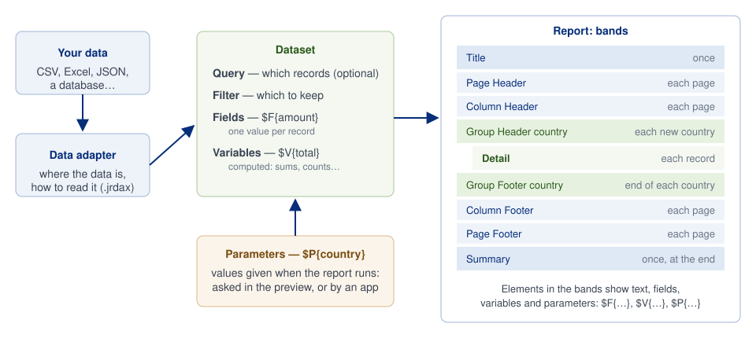
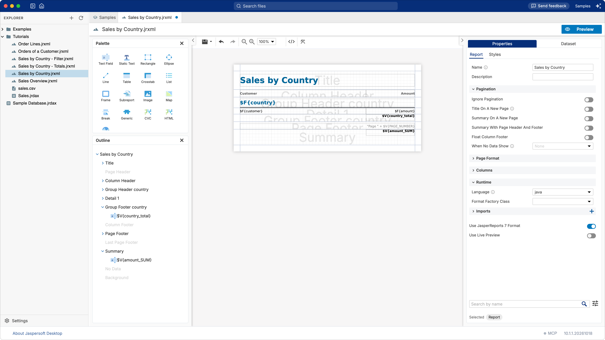
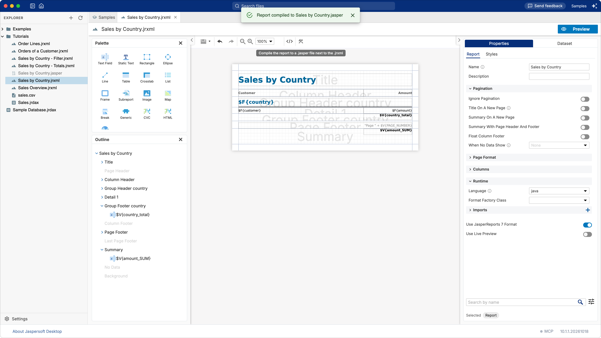

# How a report works

A few ideas explain almost everything you see in the report designer. This page is the short
version; the tutorials then put them to work, and the JasperReports documentation has every
detail.



## The data: data adapter and dataset

The **data adapter** says where the data is and how to read it: a CSV file, a database, a JSON
document (see [Working with data adapters](data-adapters.md)). It is a file of its own, so many
reports can use the same one.

The **dataset** is what the report does with that data. It has:

- a **query**, for data that needs one: SQL for a database, an expression for JSON or XML. A CSV
  or Excel file needs none: every row is a record;
- a **filter expression**, which keeps only some of the records (see
  [A filter with parameters](tutorial-parameters.md));
- the **fields**, one per column of the data: the values of the record being printed;
- the **variables**, values the report computes as it goes: a total, a count, an average;
- the **parameters**, values given from outside when the report runs.

You find all of them in the **Dataset** tab of the designer, at the right of **Properties**, when
nothing is selected.

A report has one main dataset. A table, a chart or a list inside the report can read other data:
each has a **subdataset** of its own, with its own fields, query and data adapter, filled once for
the element.

### A data adapter is not part of the report

The data adapter is how Jaspersoft Desktop gets the data while you design and preview. The report
does not depend on it. The JasperReports engine fills a report from one of two things:

- a **data source** (a `JRDataSource`), an object that hands the records over one by one;
- a **JDBC connection** (a `java.sql.Connection`), when the report has an SQL query: the engine
  runs the query on it and reads the records from the result.

A data adapter does exactly this behind the scenes. From the settings you gave it, it opens the
connection or creates the data source, and gives it to the engine.

An application that embeds JasperReports does it with its own code. It passes its own connection
(the one its pool gives it, for example) or its own data source (a `JRBeanCollectionDataSource` over
a list of its objects, for example) when it fills the report, the compiled report it loaded from a
`.jasper` file (see [Getting the .jasper file](#getting-the-jasper-file)):

```java
JasperPrint print = JasperFillManager.fillReport(jasperReport, parameters, connection);
```

The same report therefore runs:
- on the data adapter, in the designer;
- on the application's data, in production;
- on JasperReports Server, on the data source of the report unit.

What has to match is the data itself: the query must work on the database the report gets, and
the fields must have the names and the types of the columns it reads.

## Fields, variables and parameters in expressions

Whatever a report prints is an **expression**: a piece of Java (the report's **Language**, in the
report's **Properties**) that the engine evaluates. Three kinds of names can be used in them:

| You write | It is | For example |
| --- | --- | --- |
| `$F{amount}` | A field: the value in the current record | `$F{customer}` |
| `$V{total}` | A variable: a value computed by the report | `$V{PAGE_NUMBER}` |
| `$P{country}` | A parameter: a value given when the report runs | `"Sales of " + $P{country}` |

Some variables and parameters exist in every report: `$V{PAGE_NUMBER}`, `$V{REPORT_COUNT}`
(records so far), `$P{REPORT_LOCALE}`.

A **variable** is defined by what it adds up and when it starts again: for example the **Sum** of
`$F{amount}`, reset at every **group** of countries for a subtotal, or never reset for a grand
total. See [Totals and grouping](tutorial-totals.md).

## The layout: bands

The page of a report is made of **bands**, horizontal strips that the engine prints at
different moments:

| Band | Printed |
| --- | --- |
| **Title** | Once, at the beginning. |
| **Page Header**, **Page Footer** | At the top and the bottom of every page. |
| **Column Header**, **Column Footer** | Above and below the records, on every page. |
| **Detail** | Once for each record. This is where the fields usually go. |
| **Group Header**, **Group Footer** | When a group starts and ends: for each country, for example. |
| **Summary** | Once, at the end: the place for grand totals and charts of the whole report. |
| **Last Page Footer** | On the last page, in place of the page footer. |
| **No Data** | Instead of everything else, when there is no record. |
| **Background** | Behind every page, for a watermark. |

The **Outline** lists all of them. A band in grey is not in the report yet: point at it and click
its **+** to create it.



A **group** collects the consecutive records with the same value of an expression (the country,
the month of a date…). Its header and footer bands print when the value changes. The records must
be in that order: sort them in the query, or let the report sort them (the **Sort Fields** of the
dataset).

## Elements

The elements of the **Palette** are dragged onto the bands:

| Element | Prints |
| --- | --- |
| **Static Text** | Text that does not change: a label, a title. |
| **Text Field** | An expression: a field, a variable, a computation. |
| **Image** | A picture, from a file or an expression. |
| **Rectangle**, **Ellipse**, **Line** | Shapes. |
| **Frame** | A box holding other elements, to move or style them together. |
| **Table**, **List**, **Crosstab**, **Chart** | Elements with data of their own, through a subdataset. |
| **Subreport** | Another report, printed inside this one. |
| **Break** | A page or column break. |

An element prints each time its band prints: a text field in the detail band prints once per
record, in the summary band once per report.

## Subreports

A **subreport** is a report printed inside another one, the **master**. It is an ordinary report,
with its own dataset, query and bands, which the master runs through a **Subreport** element.
Like any element, it prints each time its band prints. A subreport in the detail band runs once for
each record of the master, which is how a report shows, for example, the lines of each order under
the order.

What links the two is on the **Subreport** tab of the element's **Properties**:

| Property | What it does | For example |
| --- | --- | --- |
| **Expression** | Names the report to print. | `"Order Lines.jrxml"` |
| **Set Parameters Values** | Gives values to the subreport's parameters, computed in the master. | `ORDER_ID` = `$F{ORDER_ID}` |
| **Datasource › Connection** | Gives it the master's database, to run its own query on. | `$P{REPORT_CONNECTION}` |
| **Datasource › Datasource** | Or gives it its records directly, in place of a connection. | a data source made from a field |
| **Update Main Dataset Variables** | Brings values the subreport computed back into the master's variables. | the total of the order |

The subreport's query uses the parameter to read only what belongs to the current record of the
master: `SELECT * FROM ORDER_LINES WHERE ORDER_ID = $P{ORDER_ID}`.

Drag a report from the explorer onto the page and Jaspersoft Desktop makes the subreport element,
its expression naming that `.jrxml`, which it compiles when the report runs. An application that
ships compiled reports names the `.jasper` file instead (see
[Getting the .jasper file](#getting-the-jasper-file)); the preview finds the `.jrxml` of the same
name either way. Double-click a subreport on the page to open that report in a tab of its own.
[Orders and their lines](tutorial-subreport.md) builds one step by step.

A subreport is the tool for data with a structure of its own: a list under each record, or a
second query. For a list or a table of other data placed once, a **Table** or a **List** with a
subdataset is simpler: one file, nothing to pass.

## From design to document

The `.jrxml` file you edit is the report's **design**. A document comes out of it in three steps:

1. **Compile.** The engine checks the design and turns its expressions into code. The result is
   the compiled report, saved as a `.jasper` file. The `.jrxml` is the source; the `.jasper` is
   what runs.
2. **Fill.** The engine fills the compiled report with the data and the parameters. The result is
   the finished document, still in no particular format.
3. **Export.** The document is written out as PDF, Excel, Word, HTML…

The **Preview** does all three for you, each time you look at the report, without leaving any
file behind.

### Getting the .jasper file

An application that embeds JasperReports usually ships the `.jasper` files rather than compiling
the reports each time:

```java
JasperReport jasperReport = (JasperReport) JRLoader.loadObjectFromFile("Sales by Country.jasper");
JasperPrint print = JasperFillManager.fillReport(jasperReport, parameters, connection);
JasperExportManager.exportReportToPdfFile(print, "Sales by Country.pdf");
```

To make the `.jasper` file of a report, open it in the designer and click **Compile the report to
a .jasper file next to the .jrxml**, the button with the tools in the toolbar. The file appears in
the same folder as the `.jrxml`, with the same name: `Sales by Country.jrxml` gives
`Sales by Country.jasper`. A `.jasper` already there is replaced.



Some things to know:

- **It compiles what you see.** The design in the designer is compiled, unsaved changes included.
  Save the report as well, so the `.jrxml` and the `.jasper` agree.
- **Compile again after each change.** The `.jasper` does not follow the `.jrxml` by itself.
- **Each report is compiled on its own.** A master and its subreports are separate reports: compile
  each of them.
- **A `.jasper` belongs to a version of JasperReports.** It is compiled by the JasperReports 7 that
  Jaspersoft Desktop includes, and an application should run it with the same version. An
  application with another version can compile the `.jrxml` itself, when it starts:
  `JasperCompileManager.compileReport("Sales by Country.jrxml")`.
- The button is there in local folders. On JasperReports Server, the server compiles the reports
  it runs: you publish the `.jrxml`.

## Going further

The JasperReports Library documentation, at community.jaspersoft.com, describes every element,
property and expression in detail.
