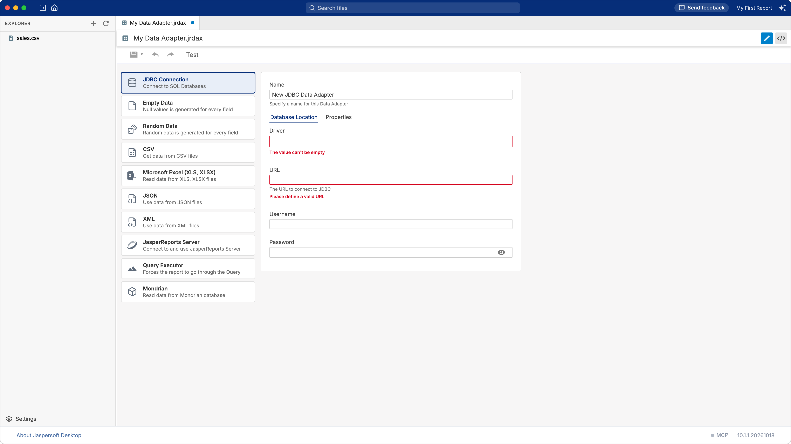
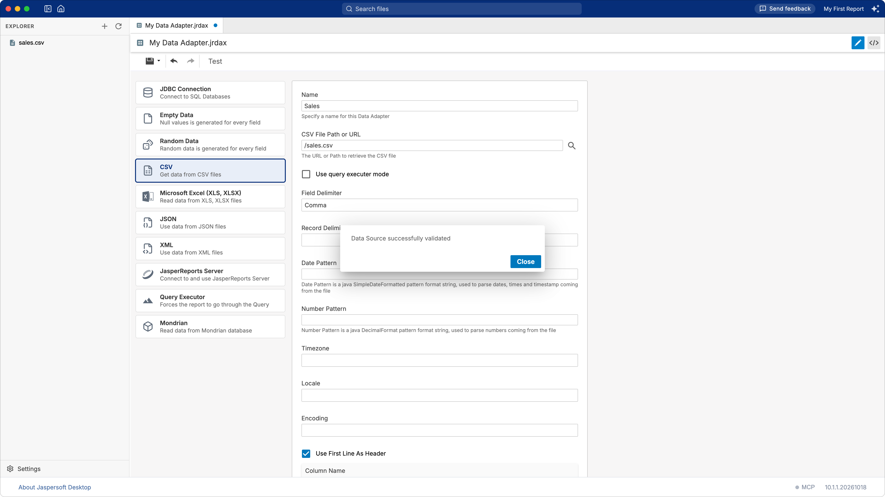
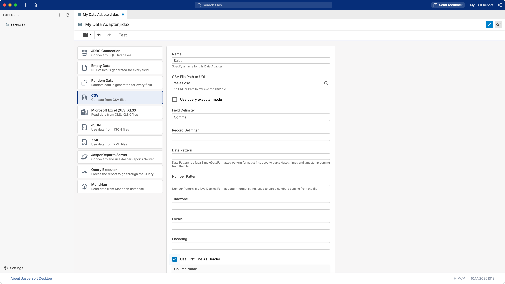
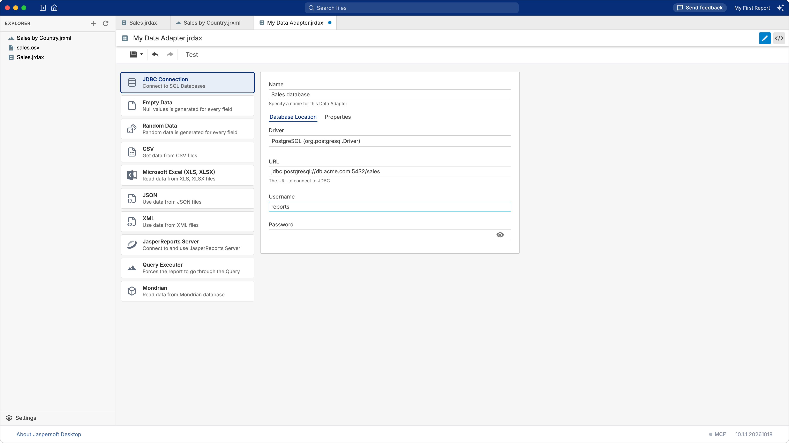
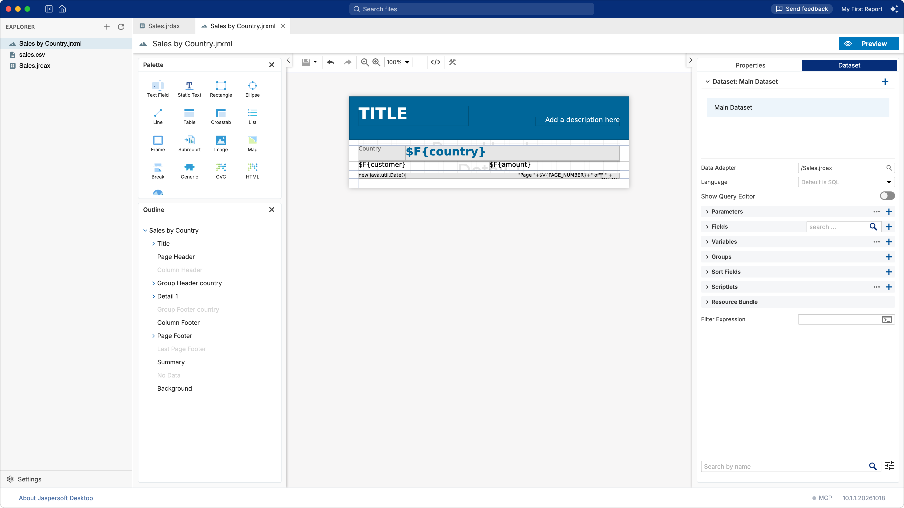

# Working with data adapters

A **data adapter** tells a report where its data comes from and how to read it: a CSV or Excel
file, a JSON or XML document, a database, a JasperReports Server. It is a small file of the
workspace, ending in `.jrdax`, that any number of reports can use.

## Creating a data adapter

Click **New Data Adapter**: on the empty page of the workspace, in the explorer's **+** menu, or
in the **New** menu of a folder (right-click it). A new data adapter opens in a tab, named
`My Data Adapter.jrdax` until you save it.

Choose the kind of data in the list on the left, and fill in the form on the right.

| Kind | For |
| --- | --- |
| **JDBC Connection** | A database: PostgreSQL, MySQL, MariaDB, Oracle, SQL Server and any other with a JDBC driver |
| **Empty Data** | A number of empty records, for a report that needs no data, or to try a layout |
| **Random Data** | A number of records with random values, to try a layout |
| **CSV** | A CSV file |
| **Microsoft Excel (XLS, XLSX)** | A sheet of an Excel workbook |
| **JSON** | A JSON document |
| **XML** | An XML document |
| **JasperReports Server** | A data source of a JasperReports Server |
| **Query Executor** | Data read by the query of the report itself |
| **Mondrian** | An OLAP cube of a Mondrian server |

Give the data adapter a **Name**, the name shown to you.

Click **Test** in the toolbar to check that the data can be read: you do not need to save first.
"Data Source successfully validated" means it can; otherwise the message says why.

Save the data adapter with the save button of the toolbar. The first time you choose its file name,
which must end in `.jrdax`. To keep the workspace tidy, you can save data adapters next to their
data, or in a folder of their own.

## Files: CSV, Excel, JSON, XML

These data adapters read a file. Give its path in the workspace, starting with `/`, for example
`/data/sales.csv`, or pick it with the search button next to the field. An address starting with
`http://` or `https://` reads the file from a web server instead; the form then shows the **HTTP
OPTIONS**: user name and password, the method, parameters and headers of the request.

**CSV**

| Option | What it does |
| --- | --- |
| **Use First Line As Header** | The first line holds the names of the columns, which become the fields. Otherwise, name the columns in the **Column Name** table, in their order. |
| **Field Delimiter** | What separates the values of a line: a comma unless you choose otherwise. |
| **Record Delimiter** | What separates the lines. |
| **Date Pattern**, **Number Pattern** | How dates and numbers are written in the file, for example `dd/MM/yyyy` and `#,##0.00`. |
| **Encoding** | The character set of the file, for example `UTF-8` or `windows-1252`. |
| **Locale**, **Timezone** | The language and the time zone the values are read in. |
| **Use query executer mode** | Lets the report's query (language `csv`) choose the columns. Leave it off unless you need it. |

**Microsoft Excel**: the file, the format (detected by default), **Use First Line As Header** and
the columns by name and index, **Sheet Selection** for a workbook with several sheets.

**JSON**: the file and a **Select Expression** that picks the records, for example `sales.items`.
**Language** chooses how the expression is written: `json` (JasperReports' own) or `jsonql`.

**XML**: the file and the **Select Expression**, an XPath expression that picks the records, for
example `/sales/item`. Choose **Use report XPath when filling the report** to let the report's own
query do it instead.

## Databases: JDBC

On the **Database Location** tab:

| Field | What to enter |
| --- | --- |
| **Driver** | The JDBC driver of your database. The list has the usual ones; another can be typed in, by its class name. |
| **URL** | Where the database is, in the driver's syntax, for example `jdbc:postgresql://db.acme.com:5432/sales`. It must start with `jdbc:`. |
| **Username**, **Password** | The account to connect with. |

The **Properties** tab sets **Auto Commit**, **Read Only**, **Transaction Isolation** and any other
property of the driver.

**The JDBC driver.** Jaspersoft Desktop includes the drivers of PostgreSQL and MariaDB (which also
connects to MySQL), and of HSQLDB, for the sample database. For another database, download its JDBC
driver (a `.jar` file) from its vendor and add it to the workspace in **Settings › Libraries** (see
[Workspace settings](workspace-settings.md)); the reports of the workspace then find it.

**No database at hand?** Jaspersoft Desktop includes one to try SQL on, with a data adapter ready
in the Samples workspace: see [The sample database](sample-database.md).

**About the password.** The password is written in the data adapter's file, as it is, not
encrypted. Anyone who can read the `.jrdax` file can read the password: use an account that can only
read the data the reports need, and do not commit the file to a shared repository with a password
in it.

## Other kinds of data

- **Empty Data** and **Random Data**: only the **Number Of Records** (10 unless you change it).
- **JasperReports Server**: the **Server** address, **Organization**, **Username**, **Password**,
  and the **Datasource Path** of a data source in the server's repository.
- **Mondrian**: the **Catalog URI** of the schema, and the database it reads, as for JDBC.

## Using a data adapter in a report

The **Report Wizard** asks for the data adapter of a new report (see
[Creating your first report](first-report.md)). To choose it for an existing report, or change it:

1. Click an empty area of the report, so that nothing is selected.
2. Open the **Dataset** tab, at the right of **Properties**.
3. In **Data Adapter**, click the search button and choose the `.jrdax` file.

The preview of the report uses this data adapter. A report with subdatasets (for tables, charts,
lists) has a **Data Adapter** for each of them as well.

**Reading the fields.** A report needs fields matching the data. Turn on **Show Query Editor** in the
**Dataset** tab: write the query when the data needs one (SQL for a database), then click **Read
Fields** to add the fields the data provides. **Preview Data** shows the first records, to check
the query.

## The AI assistant

The AI assistant can create CSV, JSON and Excel data adapters for you: attach the file to your
question, for example "make a data adapter for this file", and approve what it proposes. See
[Designing reports with AI](ai-assistant.md).
