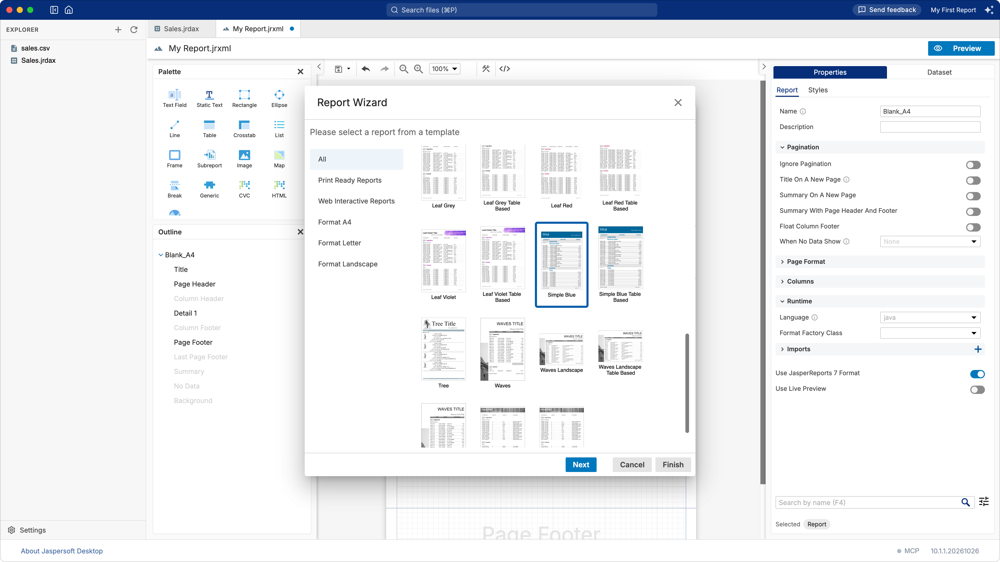
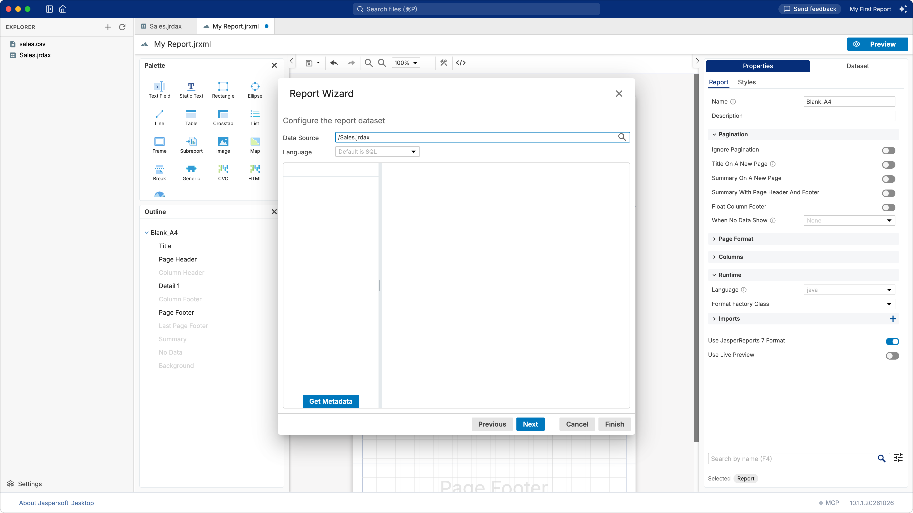
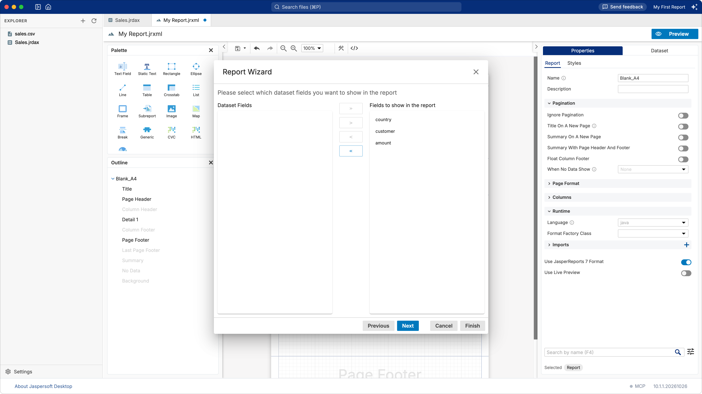
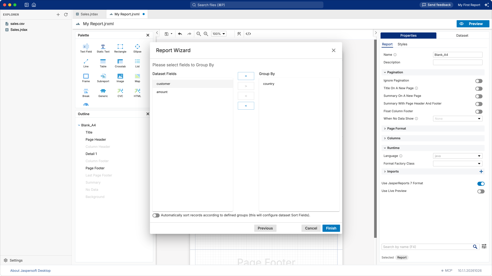
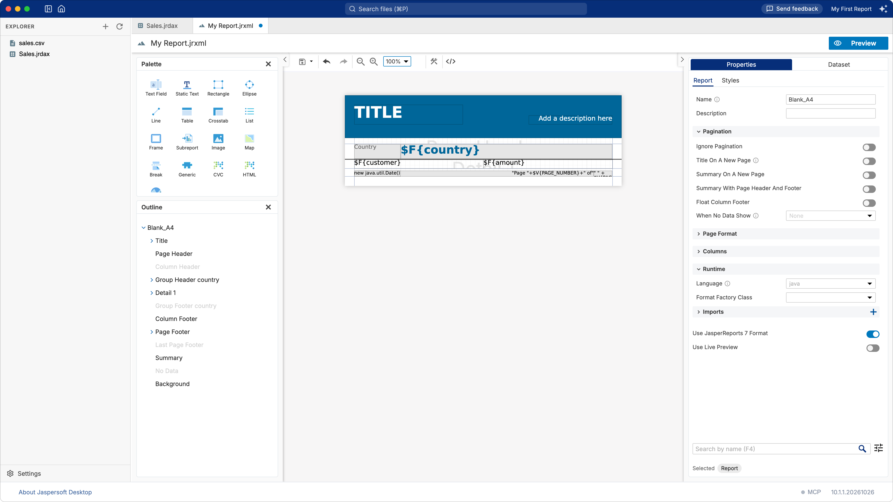
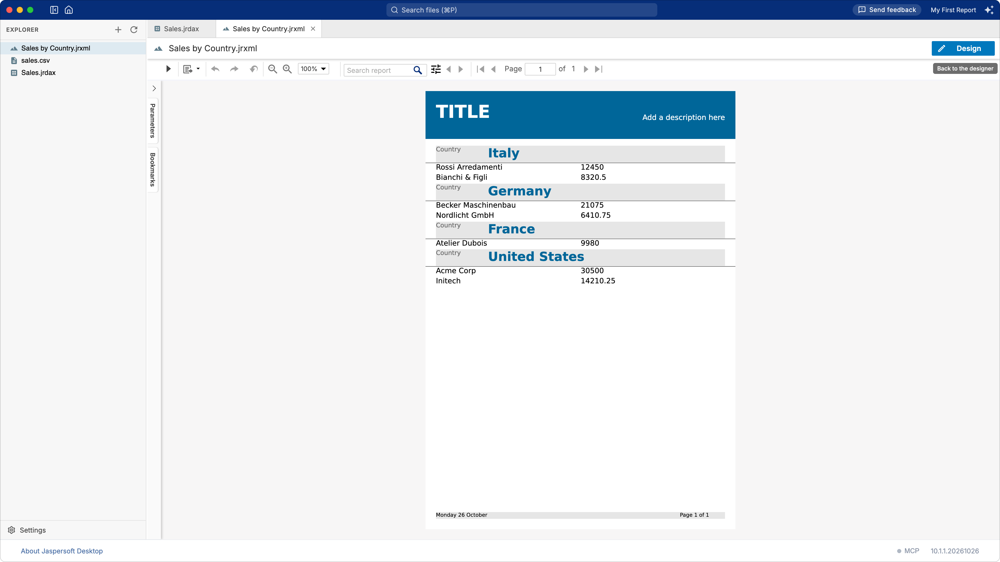
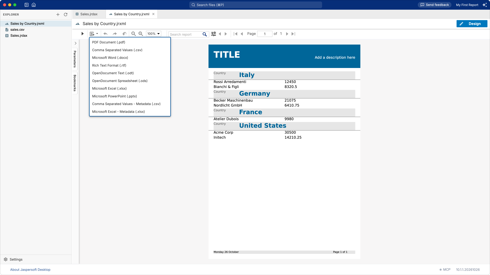

# Creating your first report

This chapter takes you from a folder with a CSV file in it to a finished report: a list of sales
grouped by country, with its preview and its exports. It takes about five minutes.

You need a folder with your data. The example uses `sales.csv`, a file like this:

```
country,customer,amount
Italy,Rossi Arredamenti,12450.00
Italy,Bianchi & Figli,8320.50
Germany,Becker Maschinenbau,21075.00
...
```

Open the folder in Jaspersoft Desktop (see [Working with workspaces](workspaces.md)). If your CSV
file is somewhere else, copy it into the folder, or use **Import File** in the explorer's **+**
menu.

## 1. Tell Jaspersoft Desktop how to read the data

A report does not read a CSV file directly: it reads it through a **data adapter**, a small file
that says where the data is and how to read it. The same data adapter can serve many reports.

1. Click **New Data Adapter** on the empty page of the workspace, or choose **Data Adapter** in the
   explorer's **+** menu. A new data adapter opens in a tab.
2. In the list on the left, choose **CSV**.
3. Fill in the form:
   - **Name**: a name for you, for example `Sales`.
   - **CSV File Path or URL**: the path of the file in the workspace, starting with `/`, for
     example `/sales.csv`. The search button next to the field lets you pick it.
   - **Use First Line As Header**: tick it when the first line of the file holds the names of the
     columns, as in the example. These names become the fields of your report.

   

4. Click **Test**, in the toolbar of the data adapter. "Data Source successfully validated" means
   the file can be read.
5. Save the data adapter (the save button of the toolbar, or **⌘S** / **Ctrl+S**), with a name
   ending in `.jrdax`, for example `Sales.jrdax`.

[Working with data adapters](data-adapters.md) explains the other options and the other kinds of
data.

## 2. Create the report with the Report Wizard

Choose **Report** in the explorer's **+** menu (or click **New Report** on the empty page of the
workspace). A new report opens, and the **Report Wizard** starts.

**Choose a template.** Templates give the report its look: pick one, for example **Simple Blue**.
**Print Ready Reports** are laid out for printing and PDF, **Web Interactive Reports** are built
on a table, for reading on screen.



**Choose the data.** In **Data Source**, click the search button and choose the data adapter you
saved, `Sales.jrdax`. Leave **Language** as it is for a CSV file.



**Choose the fields.** The wizard reads the fields of the data. Move the ones you want in the report
from **Dataset Fields** to **Fields to show in the report**, with the arrow buttons or by
double-clicking them. Their order is the order of the columns.



**Group the data** (optional). Move a field to **Group By** to group the rows by its value: here
`country`, for a section for each country. Turn on **Automatically sort records according to
defined groups** when your data is not already in that order.



Click **Finish**. You can click it on any page: the wizard does what you chose so far.

## 3. Your report in the designer



The report designer shows the page of the report divided in **bands**: the title, the header of
each group, the detail (repeated for each row of data), the page footer. Text in `$F{…}` is a field
of your data.

| Part | What it is for |
| --- | --- |
| **Palette** | Elements to drag onto a band: text, images, charts, tables… |
| **Outline** | The bands and the elements of the report, as a tree. |
| **Properties** | The properties of what is selected: the report itself when nothing is. |
| **Dataset** | Where the data comes from, the fields, parameters, variables and groups. |
| The **`</>`** button | The JRXML source of the report. |

The template left placeholders, such as **TITLE** and **Add a description here**. Select one and
change its text in the **Properties** panel.

**Save the report**: the save button of the toolbar, or **⌘S** on macOS, **Ctrl+S** on Windows and
Linux. The first time, you choose its name, for example `Sales by Country.jrxml`. Jaspersoft Desktop
never saves for you, but keeps copies of your unsaved work (see [Saving, and keeping your work
safe](workspaces.md#saving-and-keeping-your-work-safe)).

## 4. Preview and export

Click **Preview** at the top right (or **View › Preview**, **⌘⇧P** / **Ctrl+Shift+P**). The report
runs with its data and shows its pages.



The toolbar of the preview runs the report again, zooms, searches its text and moves between its
pages. A report with parameters lists them on the left, under **Parameters**: change their values
and run the report again.

To save the report as a document, open the **Export** menu, the second button of the toolbar, and
choose the format: PDF, Word, Excel, PowerPoint, OpenDocument, RTF or CSV.



Click **Design** to go back to the designer.

## What next

- Change the look: select an element and change its font, colors and borders in **Properties**.
- Add a total: drag a **Text Field** to the summary band, or ask the AI assistant to do it (see
  [Designing reports with AI](ai-assistant.md)).
- Use another kind of data, a database for example: see [Working with data adapters](data-adapters.md).
