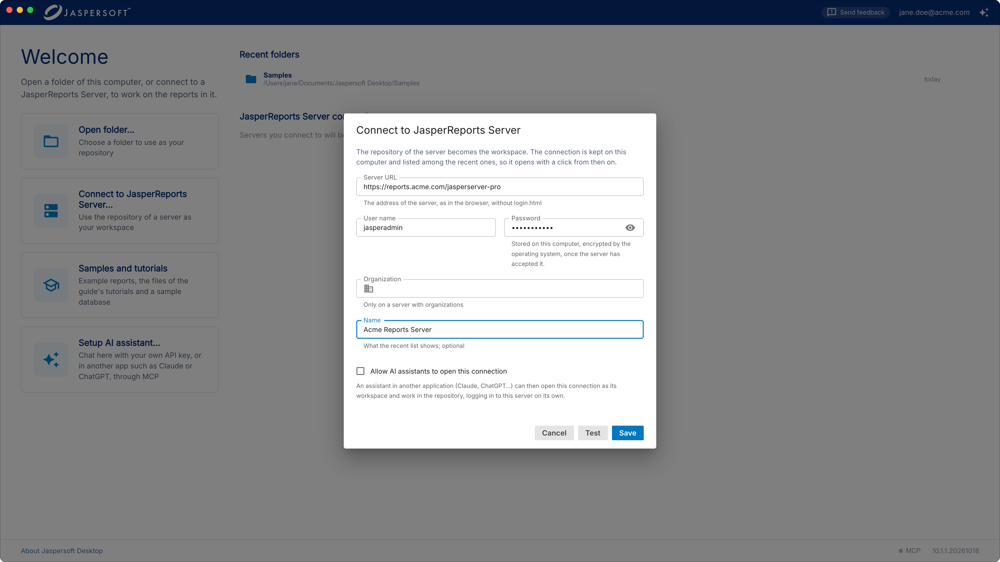
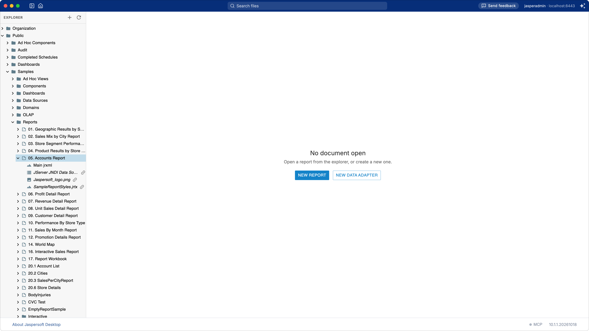
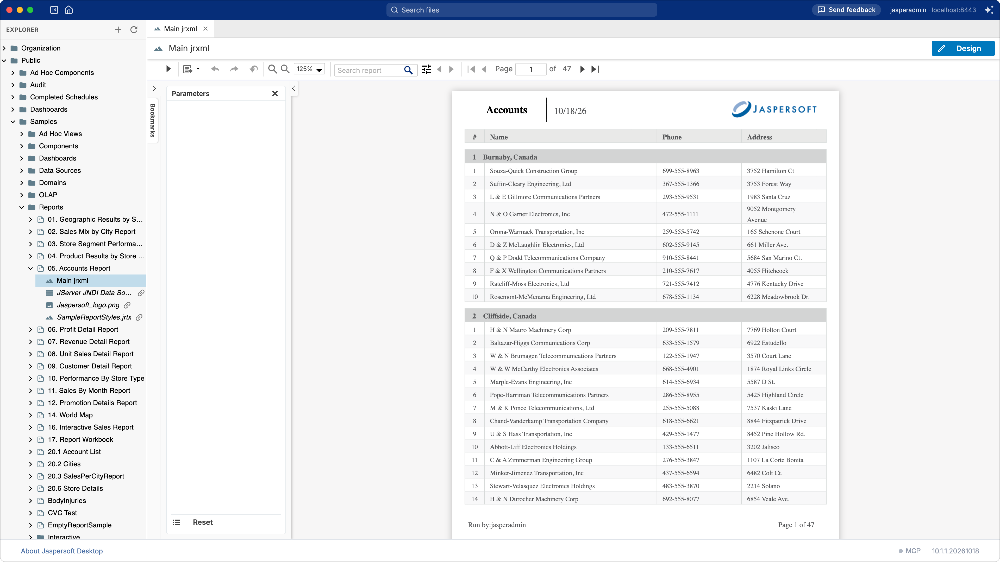
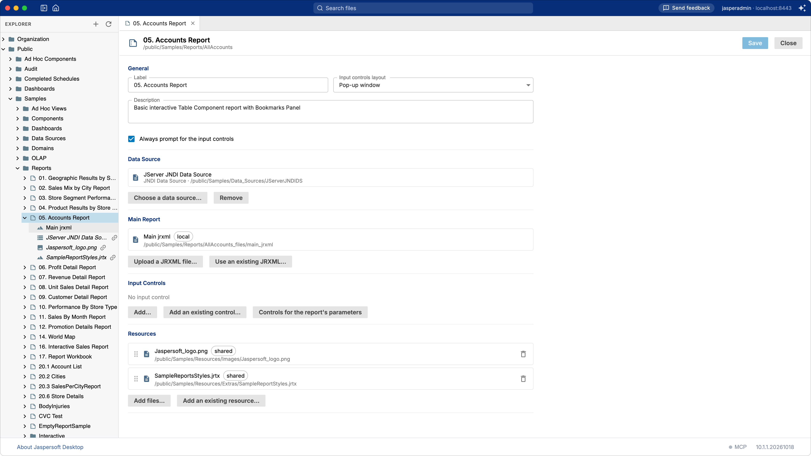
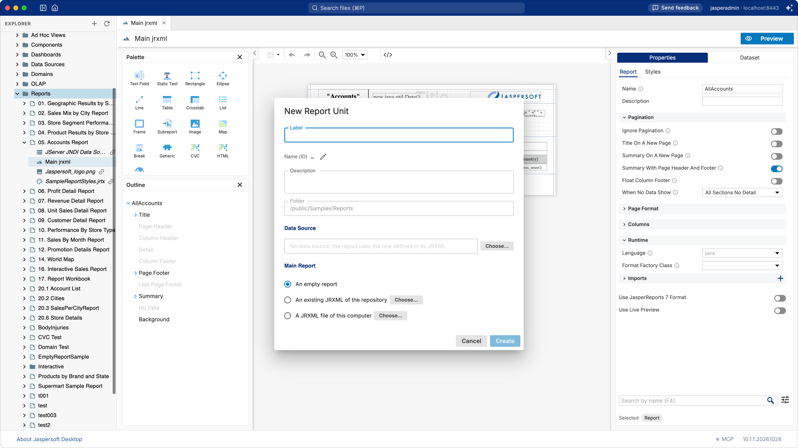

# Working with JasperReports Server

Jaspersoft Desktop works on the repository of a JasperReports Server as it works on a folder: the
server's folders and report units are in the explorer, a report opens in the designer, and saving
writes it back to the server. There is no separate step to publish a report: you work on the
server itself, and the preview runs the report there, as the server's users will see it.

## Connecting

On the home screen, click **Connect to JasperReports Server…**.

| Field | What to enter |
| --- | --- |
| **Server URL** | The address of the server as you open it in a browser, without `login.html`: for example `https://reports.acme.com/jasperserver-pro`. |
| **User name**, **Password** | Your account on the server. |
| **Organization** | On a server with several organizations, yours. Leave it empty otherwise. |
| **Name** | What the home screen calls the connection. Left empty, it is your user name and the server, `jasperadmin @ reports.acme.com`. |

Click **Connect**. The password is kept only once the server has accepted it, encrypted by the
operating system on this computer. The connection is listed under **JasperReports Server
connections** on the home screen, and opens with a click from then on; point at it to edit it or
to remove it from the list.

## The repository in the explorer

The explorer shows the folders of the server your account can see. A **report unit**, the
server's report, is a folder of its own: open it to see what it is made of.

- the **main JRXML**, the design of the report;
- its **data source**, where the server gets the data;
- its **resources**: images, style templates, subreports, resource bundles.

A name in italics, with a link, is a **shared** resource: it lives elsewhere in the repository and
other units may use it too. The others are **local**: they belong to the unit.

## Editing a report

Click the main JRXML of a unit: it opens in the designer, as a report of a folder does. Save it
with the save button of the toolbar: the server keeps the new version in the unit.

Click **Preview**: the server runs the report, with the unit's data source and its input
controls, and the pages come back to Jaspersoft Desktop.

A report of the server reads the data of the server: its unit's **data source** takes the place
the data adapter has in a folder (see
[A data adapter is not part of the report](concepts.md#a-data-adapter-is-not-part-of-the-report)).
The fonts, libraries and properties it uses are the server's too: the **Settings** of a folder
workspace have no part here.

## The report unit

Right-click a unit and choose **Edit Report Unit** to see and change all of it:

| Section | What it holds |
| --- | --- |
| **General** | The **Label** the server shows, the **Description**, how the **input controls** are laid out, and whether they are asked every time (**Always prompt for the input controls**). |
| **Data Source** | The data source of the report: **Choose a data source…** picks one of the repository, **Remove** leaves the report to the one its JRXML names. |
| **Main Report** | The JRXML: **Upload a JRXML file…** of this computer, or **Use an existing JRXML…** of the repository. |
| **Input Controls** | What the server asks before running the report. **Controls for the report's parameters** adds one for each parameter for prompting that has none yet. |
| **Resources** | The files the report uses: **Add files…** from this computer as local resources, **Add an existing resource…** of the repository as a shared one. |

Click **Save** to write the unit to the server, **Close** to leave it as it is.

## A new report unit

Right-click the folder the unit goes in and choose **New › Report Unit…**.

Give it a **Label**: the **Name (ID)**, its name in the repository, follows it unless you change it
with the pencil. Choose its **Data Source**, and where its **Main Report** comes from:

- **An empty report**, to design it from the start;
- **An existing JRXML of the repository**;
- **A JRXML file of this computer**: the way to bring to the server a report made in a folder, such
    as one of the [tutorials](tutorial-totals.md).

Click **Create**: the unit is made, and its main JRXML opens in the designer.

A report made in a folder reads its data through a data adapter, which the server does not use:
choose the unit's data source on the server's side, with the same tables and columns the report
expects. Images and subreports the report uses go into the unit as resources (**Add files…**),
under the names its expressions give them.

## What the server's users see

What Jaspersoft Desktop shows of the repository is what the server's web interface shows to the
same account, with the same permissions. A report saved here is the report the server runs from
then on, for everyone who opens it.
