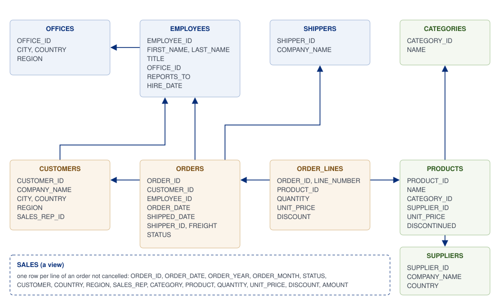

# The sample database

Jaspersoft Desktop includes a small database to try reports on: the sales of **Brightwater
Trading**, an invented wholesaler of goods for the home and the garden. It sells to shops in fifteen
countries from six offices, and holds three years of orders, 2023 to 2025. Every name in it is made
up.

It is there as soon as Jaspersoft Desktop starts: there is nothing to install, no server to run, no
file to look for. It can only be read: a report cannot change it.

## Connecting to it

The **Samples** workspace (home screen, **Samples and tutorials**) has its data adapter ready,
`Sample Database.jrdax`. To use the database in another workspace, create a **JDBC** data adapter
(see [Working with data adapters](data-adapters.md)) with:

| Setting | Value |
| --- | --- |
| **JDBC Driver** | `org.hsqldb.jdbc.JDBCDriver` |
| **JDBC URL** | `jdbc:hsqldb:res:/sample-database/sample` |
| **Username** | `SA` |
| **Password** | empty |

The database works only inside Jaspersoft Desktop: the URL names a resource of the application,
not a file or a server another program could reach.

## Its tables



| Table | Rows | What it holds |
| --- | --- | --- |
| `ORDERS` | 2,791 | An order: its customer, the employee who took it, the dates (`ORDER_DATE`, `REQUIRED_DATE`, `SHIPPED_DATE`), the shipper, the freight and the `STATUS`: `Shipped`, `Pending` (not shipped yet, at the end of 2025) or `Cancelled`. |
| `ORDER_LINES` | 9,035 | The lines of an order (`ORDER_ID`, `LINE_NUMBER`): the product, the `QUANTITY`, the `UNIT_PRICE` of that day and the `DISCOUNT` (0, 0.05 or 0.10). |
| `CUSTOMERS` | 88 | The shops: name, contact, address, `COUNTRY`, `REGION` and the sales representative who follows them (`SALES_REP_ID`). |
| `PRODUCTS` | 64 | The catalog: name, category, supplier, today's `UNIT_PRICE`, the stock, and whether it is `DISCONTINUED`. |
| `CATEGORIES` | 8 | Kitchen, Tableware, Home Decor, Lighting, Textiles, Storage, Garden, Outdoor Living. |
| `SUPPLIERS` | 10 | Who makes the products. |
| `EMPLOYEES` | 19 | The staff: a chief executive, three sales directors and the sales representatives, each with the one they report to (`REPORTS_TO`) and an `OFFICE_ID`. |
| `OFFICES` | 6 | Milan, Hamburg, London, Chicago, São Paulo and Sydney, each in a `REGION`: Europe, North America, Latin America, Asia Pacific. |
| `SHIPPERS` | 3 | The carriers of the orders. |

The names are in capitals, as the database returns them: a report's fields are `$F{ORDER_DATE}`,
`$F{COUNTRY}`. A query can write them in any case (`select order_date from orders`).

## The view SALES

`SALES` is a view: one row per line of an order that was not cancelled, with what a first report
wants beside it, so that no join is needed:

| Column | |
| --- | --- |
| `ORDER_ID`, `ORDER_DATE`, `ORDER_YEAR`, `ORDER_MONTH`, `STATUS` | The order |
| `CUSTOMER`, `COUNTRY`, `REGION` | Who bought |
| `SALES_REP` | Who sold, first and last name |
| `CATEGORY`, `PRODUCT` | What was sold |
| `QUANTITY`, `UNIT_PRICE`, `DISCOUNT` | The line |
| `AMOUNT` | What the line is worth: quantity × price × (1 − discount) |

For example, the sales of each country in 2025:

```sql
SELECT COUNTRY, SUM(AMOUNT) AS SALES
FROM SALES
WHERE ORDER_YEAR = 2025
GROUP BY COUNTRY
ORDER BY SALES DESC
```

## What is in the data

The data is made so that reports have something to show:

- the business grows by about a fifth each year, and every year sells most in November and
    December;
- a few customers buy a lot and many buy a little, for rankings;
- prices rise by 4% a year: `ORDER_LINES.UNIT_PRICE` is the price of the day, `PRODUCTS.UNIT_PRICE`
    today's;
- two products were discontinued in 2024;
- the last orders of 2025 are still `Pending`, and about one order in fifty is `Cancelled`.

The database is the same in every copy of Jaspersoft Desktop of a version, so the figures in the
tutorials are the ones you get.
