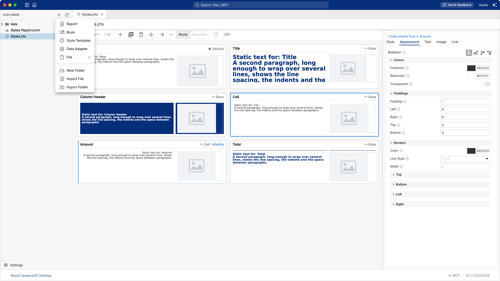
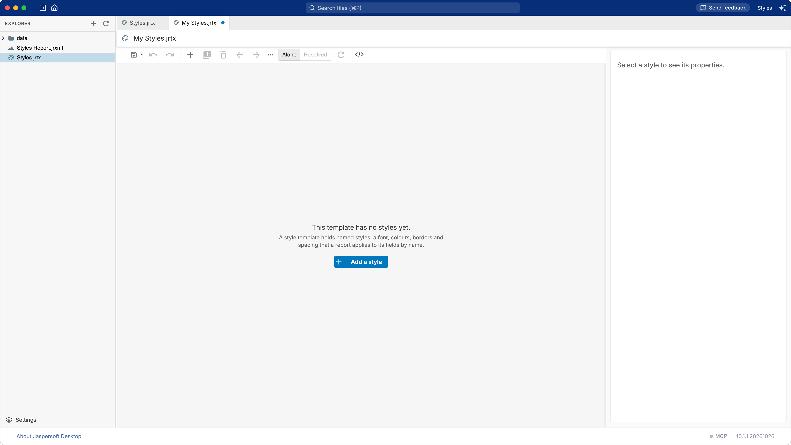
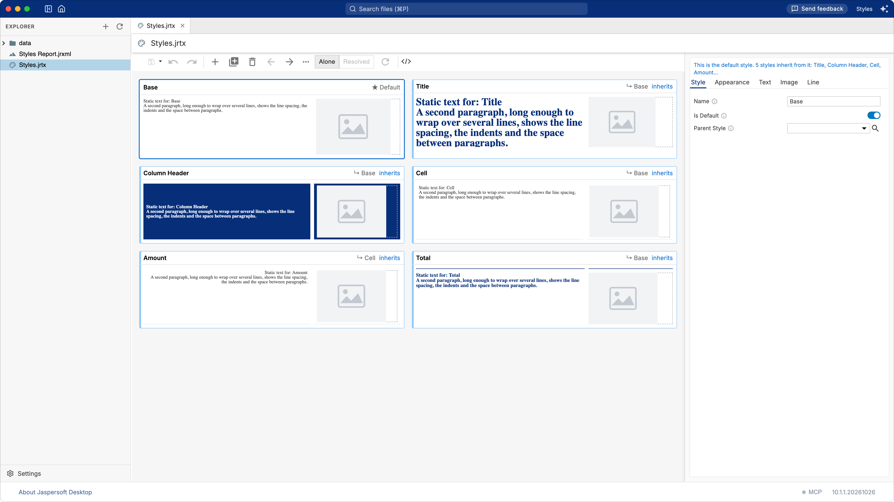
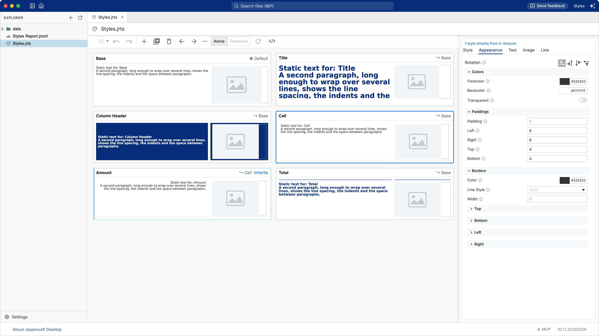
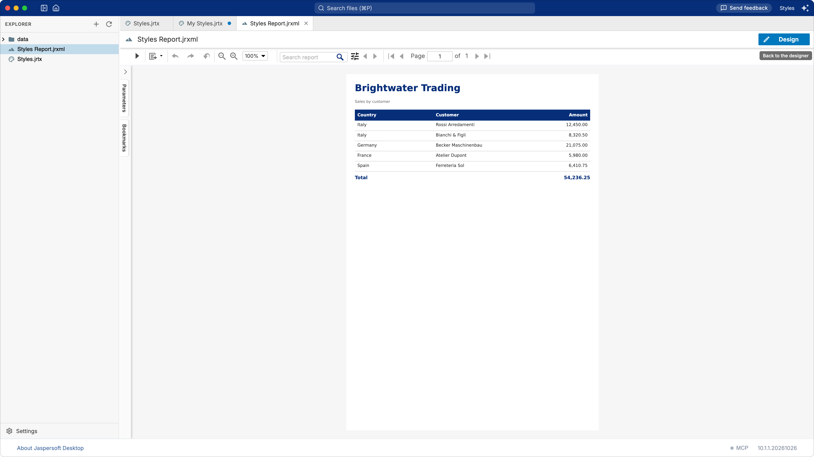

# Working with style templates

A **style template** is a file of named styles that reports apply by name: the styles of
JasperReports. A style holds what several fields should look alike in — the font, the colours,
the borders, the padding, the spacing of a paragraph — and a report that uses the template gives
its fields the name of a style instead of the same settings one field at a time. It is a file of
the workspace, ending in `.jrtx`, that any number of reports can use.

Change the style in the template, and every report that uses it changes with it. That is the
reason to keep one: a house style, written once.

## Creating a style template

Choose **Style Template** in the **New** menu of a folder — the **+** at the top of the explorer,
or a right-click on the folder.

A new template opens in a tab, called `My Styles.jrtx` until you save it under another name.

A new template holds no styles yet, and says so. Press **Add a style** — it is the quickest way
in, and the same as the **+** of the toolbar.

## The styles as cards

Each style of the template is a card: its name, the text it gives a field, how it gives an image,
and whether it is the default style or inherits from another. The properties of the style you
select are on the right, in the column the report designer uses for its own properties.

Select a style with a click. **Ctrl-click** (**⌘-click** on macOS) selects several, and
**Shift-click** a range; a change is then made to all of them at once, in one step of undo. The
toolbar and the menu of a card — a right-click, or the **…** of the toolbar — also:

| Action | How |
| --- | --- |
| Add a style | The **+** of the toolbar |
| Rename | Double-click the name, or press **F2** |
| Delete | The **Delete** key, or the menu |
| Copy, cut, paste | **Ctrl-C**, **Ctrl-X**, **Ctrl-V** — styles go between templates, and into the report designer's styles |
| Duplicate | The menu |
| Move | The arrows of the toolbar |

A name must be unique: the template marks a card whose name another card has, because a report
uses only the last of them.

## The properties of a style

The column on the right holds the properties of the selected style, in five groups: **Style**,
**Appearance**, **Text**, **Image** and **Line**.

A value shown greyed out is not the style's own: it comes from the style it inherits from, or
from JasperReports. The **i** beside a field says where from. Clear a value — the small **×** in
its field, or by emptying it — and the style inherits that property again.

The note above the tabs says who else a change reaches: the styles that inherit from the selected
one, since a property they do not set themselves follows it.

Everything you change stays in the designer until you save. **Ctrl-S** saves the template to its
file; **Save As** writes it under another name, and **Download** writes a copy to your computer.

## Parents, the default style, and includes

A style can inherit from another style of the template: choose it in **Parent Style**. The style
then sets only what it changes, and takes everything else from its parent. The list leaves out
the styles that would make a loop — a style cannot inherit from itself, or from one that already
inherits from it.

One style can be the **default** of the template, with **Is Default** on: the one a report applies
to a field that names no style. A template has one default at most.

A template can also use the styles of other templates. Two ways:

- **Includes**: a template lists other templates, and their styles come with its own. The
  includes are shown above the cards.
- **Parent Style** from another template: the search button beside the list picks a template of
  the workspace, then one of its styles, and the template is added to its includes.

The **Alone** and **Resolved** buttons of the toolbar choose what you see. **Alone** is the
template by itself; **Resolved** adds the styles of the templates it includes, dimmed, as a
report gets them. **Reload** reads the included templates again after they change.

## Using a template in a report

In the report designer, open the **Styles** section of the properties. Its menu has **Add external
style template**: a reference to a template of the workspace is added, and its expression holds a
path — `"path/to/style.jrtx"` until you write it. Drag the template from the explorer onto the
list instead, and the reference points where the file lies, as a report or a picture dropped on
the page does. A report can use several templates; the styles are collected in order, and the
templates are asked first.

A field then wears a style by its name: in the properties of the field, **Style** is the name of
the style, for example `Column Header`. A field that names no style gets the default style of the
template.

The report of the picture below reads a small CSV file through a data adapter, and holds only the
names of the styles: `Title` for its heading, `Column Header` for the columns, `Cell` and `Amount`
for the rows, `Total` for the sum. What those styles look like is in the template, so a change
made there reaches every report that names them.

The other direction is also there: select the styles of a report and choose **To Style Template
File…** in the menu of the styles list. They are written to a new template, or added to one that
exists, and the report uses that file instead.

## The file itself

The **Source** tab shows the template as XML, and every change made in **Design** is written
there. A hand-written template is opened the same way, and the whitespace, comments and settings
the designer does not show stay as they were when it is saved.

JasperReports 6 and older take the same file written by their own schema. A template saved from
this application is in the newer format; a report of the older format reads both.

## Asking the assistant to shape a template

The AI assistant of the workspace changes a style template the same way it changes a report.
Open the template on its **Design** tab and ask, for example, "make the column header style
lighter, and add a total style that inherits from it". The change is made in the designer, in one
step of undo, and nothing is saved until you save or the assistant does.

The assistant reads the template and the properties a style has before it changes anything, so it
uses the names and the values JasperReports knows. It can also create a template from scratch —
a base style, the styles that inherit from it, and the ones reports use — in a folder you choose.
See [Designing reports with AI](ai-assistant.md) for the assistant and the MCP server.
