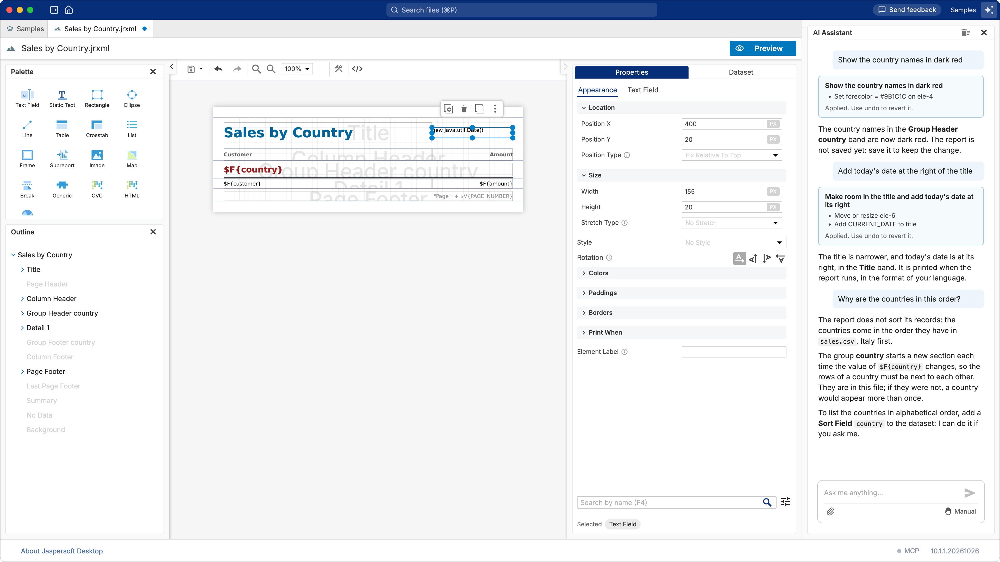
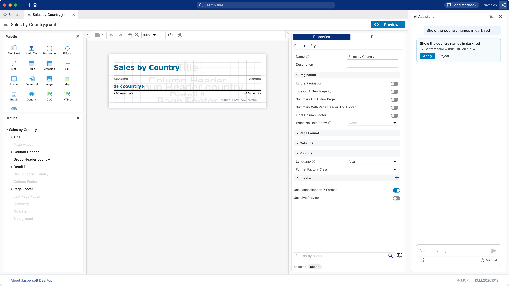
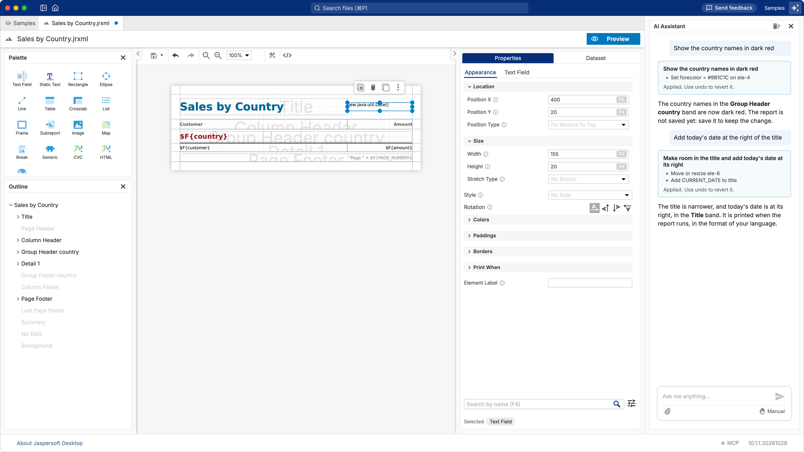

# Tutorial: working with the AI assistant

**What you do:** ask the assistant for two changes to a report, check them, take one back, and ask
it a question about the report. **What you learn:** how the assistant proposes a change, how to
read a proposal before applying it, and how to undo what it did. **Time:** about 10 minutes.

## Before you start

- The assistant inside Jaspersoft Desktop must be set up with your model service (Anthropic,
    OpenAI, Google, Ollama…): see [Designing reports with AI](ai-assistant.md). An assistant in
    another application, through MCP, works on the same report the same way, but you chat with it
    there.
- Open `Tutorials/Sales by Country.jrxml` in the **Samples** workspace (see
    [Totals and grouping](tutorial-totals.md#before-you-start)).
- Show the assistant's column: **Show AI Assistant**, the button with the stars at the right of the
    title bar. To give the page more room, hide the explorer: **Hide Explorer**, the first button of
    the title bar.

The assistant reads the report you have on show, and the workspace around it: you do not need to
explain which report, or paste anything.

A model does not answer twice in the same words: what you get will not be exactly what the pictures
show, but it will do the same things.

## 1. Ask for a change

Type in the box at the bottom of the column:

> Show the country names in dark red

and press **Enter**. The assistant does not change the report at once: it **proposes** the change,
in a card that says what it will do.

Read it before you click. Here it sets the text color (`forecolor`) of one element, `ele-4`: the
`$F{country}` text field of the **Group Header country** band. Each element of the report has such
an id; the assistant uses them to say exactly what it changes.

Click **Apply**. The country names on the page turn dark red, and the assistant says what it did.
**Reject** would have left the report as it was.

## 2. Take it back

Every change the assistant makes is a change of the designer like yours: click **Undo** in the
toolbar (or **⌘Z**, **Ctrl+Z** on Windows and Linux) and the names are blue again; **Redo** brings
the change back. Keep it: click **Redo**.

Nothing is saved until you save: the assistant changes the report on show, never the file behind
your back.

## 3. A change in several steps

Ask:

> Add today's date at the right of the title

This needs two changes, and the card lists both: the title made narrower (**Move or resize**
`ele-6`), to leave room, and the date added in the **Title** band (**Add CURRENT_DATE**). One
**Apply** makes them together, and one **Undo** takes them back together.

## 4. Ask a question

The assistant answers questions about the report as well, without changing it:

> Why are the countries in this order?

It explains that the report does not sort its records, so the countries come in the order of the
file, and how to sort them. A question gets an answer, not a proposal; ask for the change if you
want it ("Sort the countries alphabetically").

Save the report to keep the two changes.

## Asking well

- **Name what you see.** "The amounts in the detail band", "the title", "the second column of the
    table": the assistant reads the same report you see.
- **One thing at a time** is easier to check than five in one request.
- **Ask it to check.** "Does this report compile?", "Why does the preview fail?": it can run the
    report's check and read the error.
- **It knows the data.** It can read the fields of a data adapter, write a query, add fields,
    parameters and variables, make a chart or a table.

## Manual or automatic

Under the box, **Manual** means what you saw: every change is proposed, and waits for **Apply**.
Switch it to **Edit automatically** and the assistant changes the report without asking, each change
one step of **Undo**. What **Undo** cannot take back is always asked for, whatever the mode: saving,
creating files and folders or data adapters, running a query on your data, changing a report unit
of JasperReports Server.

## What you learned

- The assistant **proposes** changes; read the card, then **Apply** or **Reject**.
- What it changes, **Undo** takes back, like any change of yours; nothing is saved until you save.
- One request can need several changes: they are applied and undone together.
- A question gets an answer, a request for a change gets a proposal.
