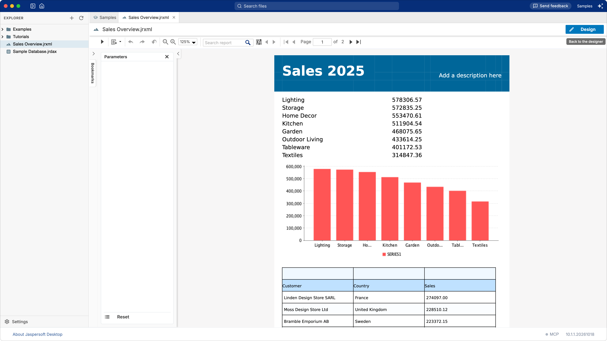
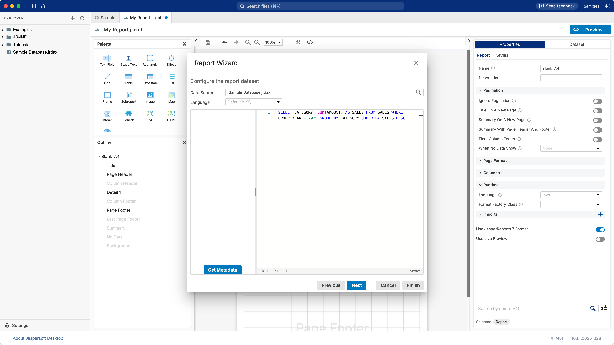
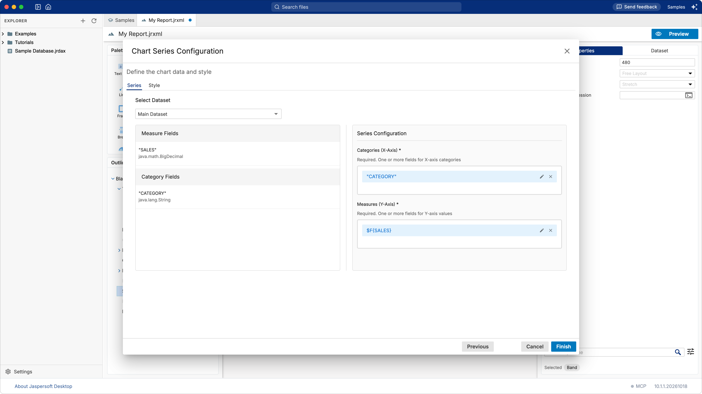
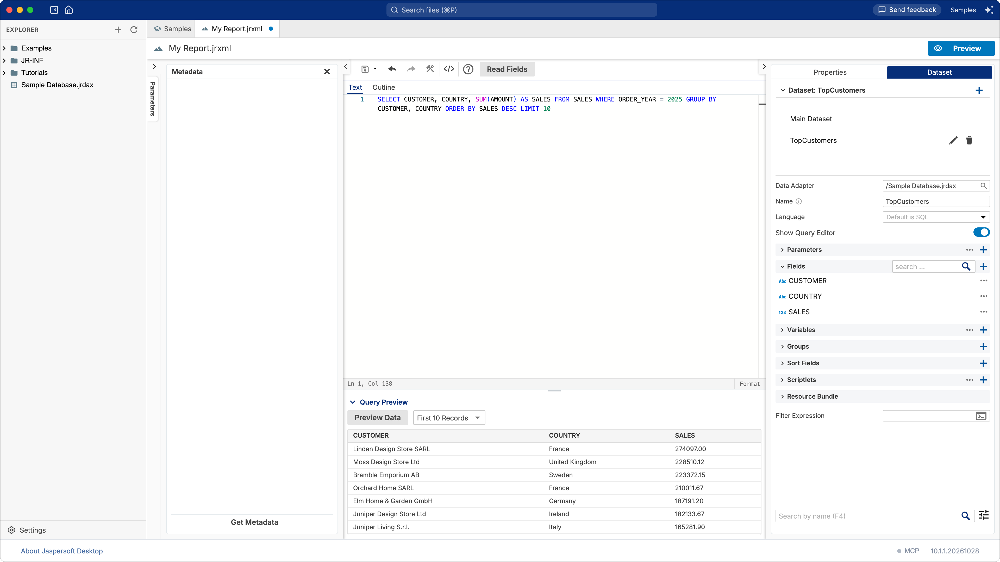
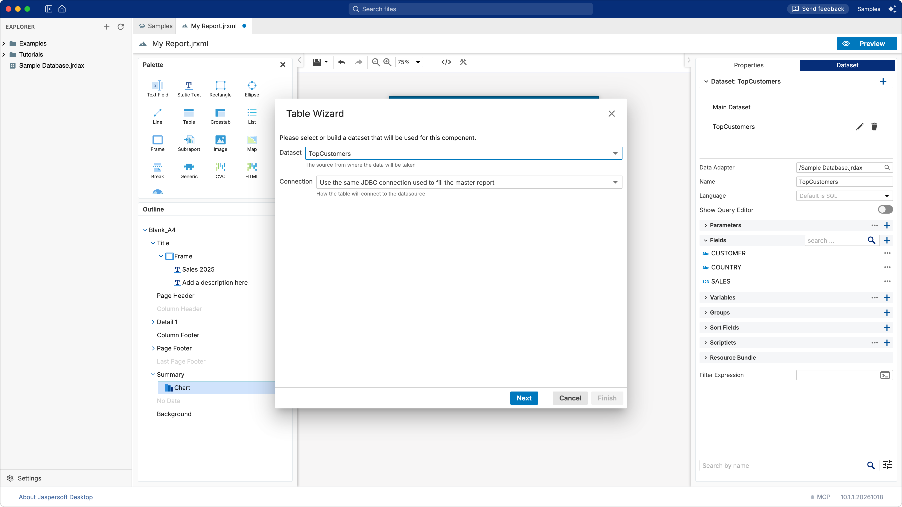
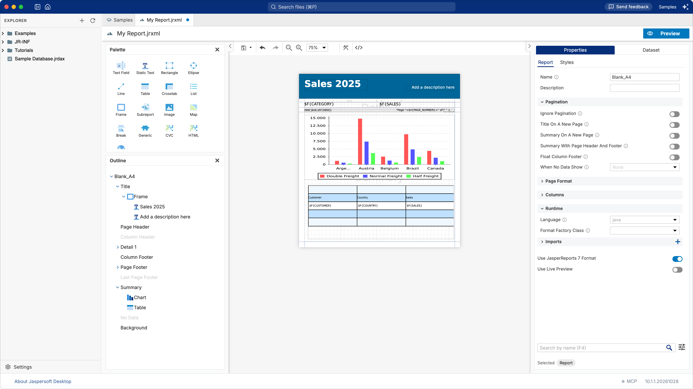

# Tutorial: a chart and a table

**What you build:** a one-page overview of the sales of 2025, from the sample database: the sales
of each category, a bar chart of them, and a table of the ten best customers. **What you learn:** a
report on an SQL query, a chart, a second dataset (a **subdataset**) and a table that reads it.
**Time:** about 20 minutes.



## Before you start

You work in the **Samples** workspace: on the home screen, click **View samples and tutorials** (see
[Totals and grouping](tutorial-totals.md#before-you-start)). The data comes from the sample
database that Jaspersoft Desktop includes, through the data adapter `Sample Database.jrdax` at the
top of the workspace. [The sample database](sample-database.md) describes its tables; this tutorial
uses its view `SALES`, one row per order line with the customer, the category and the amount.

If subdatasets are new to you, [How a report works](concepts.md#the-data-data-adapter-and-dataset)
explains them in a few lines.

## 1. A report on an SQL query

1. Choose **Report** in the explorer's **+** menu.
2. Choose the template **Simple Blue**, then **Next**.
3. In **Data Source**, type `/Sample Database.jrdax` (or pick it with the search button). The
    editor of the query opens below it. Type:

    ```sql
    SELECT CATEGORY, SUM(AMOUNT) AS SALES
    FROM SALES
    WHERE ORDER_YEAR = 2025
    GROUP BY CATEGORY
    ORDER BY SALES DESC
    ```

    

4. Click **Next**. Jaspersoft Desktop runs the query to learn its columns, the **fields** of the
    report: `CATEGORY` and `SALES`. Double-click both, then click **Finish**.

The report prints one line per record of the query: eight categories with their sales.

## 2. A title, and room at the end

1. Click **TITLE** on the page. In **Properties**, on the **Static Text** tab, set **Text** to
    `Sales 2025`.
2. In the **Outline**, select **Summary**: the template leaves it empty, 0 high. Set its **Height**
    to `480`.

The **Summary** band prints once, after all the records: the place for a chart of them.

## 3. The chart

1. In the **Palette**, under **Charts**, drag **Chart** onto the **Summary** band.
2. Choose **Bar Chart**, then **Next**.
3. The chart reads the **Main Dataset**, the data of the report. Drag `"CATEGORY"` onto
    **Categories (X-Axis)** and `"SALES"` onto **Measures (Y-Axis)**: a bar for each category, as tall
    as its sales.

    

4. Click **Finish**. In the **Outline**, select **Chart**, and on the **Appearance** tab of
    **Properties** set **Position X** `0`, **Position Y** `10`, **Width** `555`, **Height** `240`.

The chart collects the values of every record as the report goes, and draws them when it prints:
in the Summary band, once, with all of them. The designer shows a sample chart in its place; the
preview shows the real one.

## 4. A second dataset

The ten best customers are another query, which the report's dataset cannot answer: it returns
categories. A **subdataset** is a dataset of its own inside the report, with its query and its
fields, for a table, a chart or a list.

1. Open the **Dataset** tab and click the **+** of **Dataset: Main Dataset**. A dataset named
    `Dataset` is added to the list: select it.
2. Set its **Name** to `TopCustomers` and its **Data Adapter** to `/Sample Database.jrdax`.
3. Turn on **Show Query Editor**. The editor of the query takes the place of the page. Type:

    ```sql
    SELECT CUSTOMER, COUNTRY, SUM(AMOUNT) AS SALES
    FROM SALES
    WHERE ORDER_YEAR = 2025
    GROUP BY CUSTOMER, COUNTRY
    ORDER BY SALES DESC
    LIMIT 10
    ```

4. Click **Read Fields**: `CUSTOMER`, `COUNTRY` and `SALES` appear under **Fields**. Click
    **Preview Data** to see the first records.

    

5. Turn **Show Query Editor** off, to see the page again.

## 5. The table

1. Drag **Table** from the **Palette** onto the **Summary** band, near its left edge, under the
    chart. The columns of a new table share the width of the page from where you drop it.
2. The **Table Wizard** asks which dataset fills the table: choose **TopCustomers**. Leave
    **Connection** as it is, **Use the same JDBC connection used to fill the master report**: the
    table runs its query on the database the report reads, through `$P{REPORT_CONNECTION}`.

    

3. Click **Next**, then **≫** to make a column of each field, then **Next** and **Finish**.
4. In the **Outline**, select **Table**, and on the **Appearance** tab set **Position X** `0` and
    **Position Y** `270`: under the chart.



## 6. Save and preview

Save the report (the save button of the toolbar) as `Sales Overview.jrxml`, then click **Preview**:
the categories, their chart, and the ten customers who bought most in 2025, Linden Design Store
SARL first.

## Going further

- **Format the amounts.** Select a text field of `SALES` (in the detail band, or in the table's
    detail cell) and set its **Pattern** to `#,##0.00`.
- **Another kind of chart.** A **Pie Chart** shows the same series as shares of the whole.
- **A year chosen when the report runs.** A parameter `Year` in the report, used in its query
    (`WHERE ORDER_YEAR = $P{Year}`), and passed on to the subdataset by the table's dataset run (its
    **Parameters**, in the table's properties), so that both answer for the same year. See
    [A filter with parameters](tutorial-parameters.md).

## What you learned

- A report reads an **SQL query** through a JDBC data adapter; the wizard makes the fields of its
    columns.
- A **chart** collects the values of every record; in the **Summary** band it draws them all.
- A **subdataset** is a second query in the report, for an element of its own: here a **table**.
- A table on a subdataset of the same database runs its query on the report's connection.
