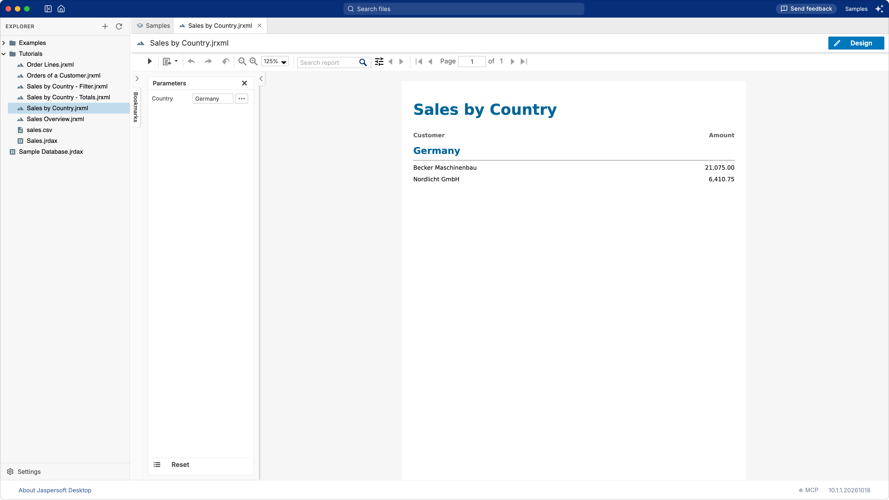
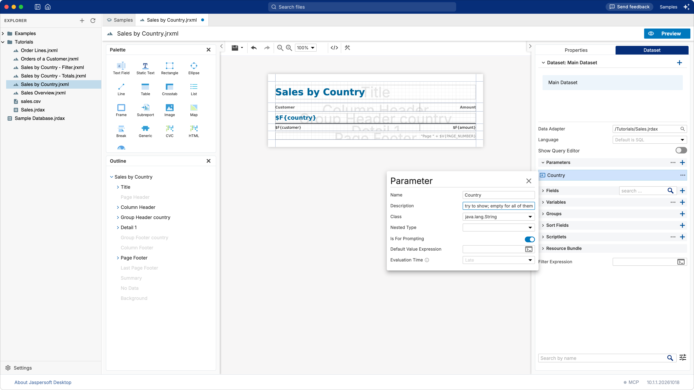
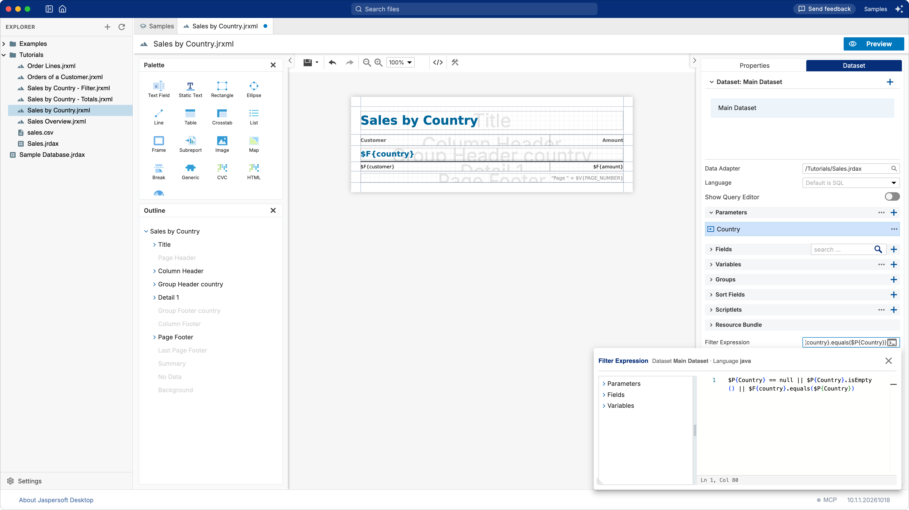

# Tutorial: a filter with parameters

**What you build:** the sales report asks for a country when it runs, and shows only that country's
sales; or all of them when no country is given. **What you learn:** parameters, the filter of a
dataset, and giving values to a report in the preview. **Time:** about 10 minutes.



## Before you start

Open `Tutorials/Sales by Country.jrxml` in the **Samples** workspace, as in
[Totals and grouping](tutorial-totals.md): as you left it after that tutorial, or as it was (see
[Starting again from the samples](tutorial-totals.md#starting-again-from-the-samples)).

## 1. The parameter

A **parameter** is a value given to the report when it runs: in the preview you type it, an
application embedding the report passes it, JasperReports Server asks it with an input control.

1. Click an empty area of the page, so that nothing is selected, and open the **Dataset** tab.
2. Expand **Parameters** and click its **+**. A parameter named `Parameter` is added.
3. Right-click it and choose **Edit**. Set:

   | Property | Value |
   | --- | --- |
   | **Name** | `Country` |
   | **Description** | `The country to show; empty for all of them`. The preview shows it as the tip of the field. |
   | **Class** | `java.lang.String`, as it is: a text. |
   | **Is For Prompting** | On, as it is: the preview asks for it. |

   

   Close the editor with its **×**.

## 2. The filter

The data adapter reads every row of `sales.csv`. The **Filter Expression** of the dataset decides
which records the report keeps: those for which it is true.

In the **Dataset** tab, type in **Filter Expression** (at the bottom), or click the button at the end
of the field to write it in the expression editor, with the fields and parameters at hand:

```java
$P{Country} == null || $P{Country}.isEmpty() || $F{country}.equals($P{Country})
```



Read it as: keep the record when no country was given (`null`, or an empty text), or when its
country is the one given. The expression is Java, the language of the report:

- `$P{Country}` is the parameter, `$F{country}` the field of the current record;
- `||` means *or*;
- `.equals(…)` compares two texts. Do not use `==` for texts.

A report with a query can filter in the query instead, which is faster on a large database: in SQL,
`WHERE country = $P{Country}`. A CSV file has no query, so the filter is the way.

## 3. Run it

1. Click **Preview**. The **Parameters** panel on the left lists **Country**, empty: the report
   shows every country.
2. Type `Germany` in **Country** and click **Run**, the first button of the toolbar (▶).

Only Germany is left. Clear the field and run again to see every country.

Changes to the design are taken into account when you go back to **Design** and then to
**Preview** again; **Run** fills the same design with new values.

## Going further

- **A default value.** The **Default Value Expression** of a parameter is used when no value is
  given, for example `"Italy"`.
- **A title that says what was chosen.** Replace the static title with a **Text Field** whose
  expression is
  `$P{Country} == null || $P{Country}.isEmpty() ? "Sales by Country" : "Sales in " + $P{Country}`.
- **Other kinds of values.** A parameter of class `java.util.Date` gets a date picker in the
  preview, `java.lang.Boolean` a checkbox, `java.lang.Integer` a number field.
- **On JasperReports Server**, each parameter for prompting becomes an **input control** of the
  report unit, which can offer a list of values to choose from.

## What you learned

- **Parameters** bring values into the report when it runs; **Is For Prompting** makes the preview
  ask for them.
- The **Filter Expression** keeps only the records for which it is true.
- Expressions are Java: `$P{…}` for parameters, `$F{…}` for fields, `.equals` to compare texts.
