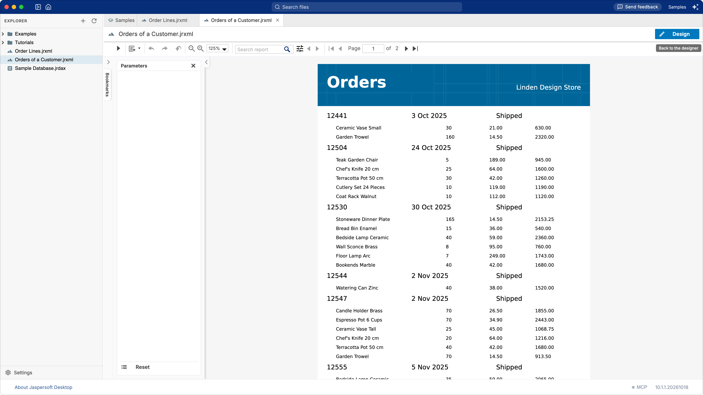
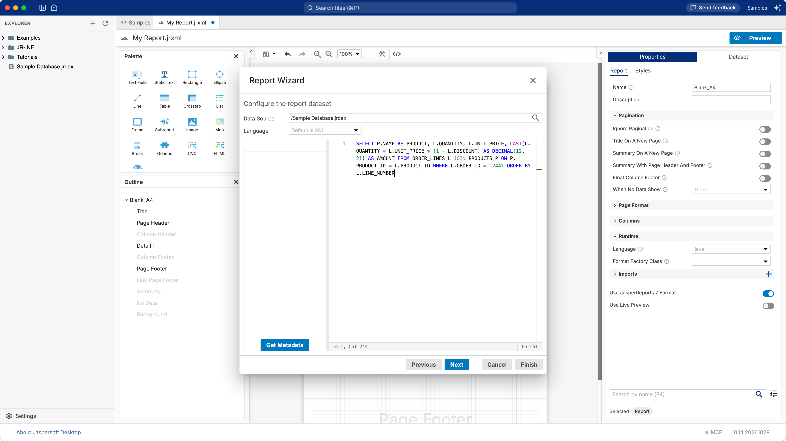
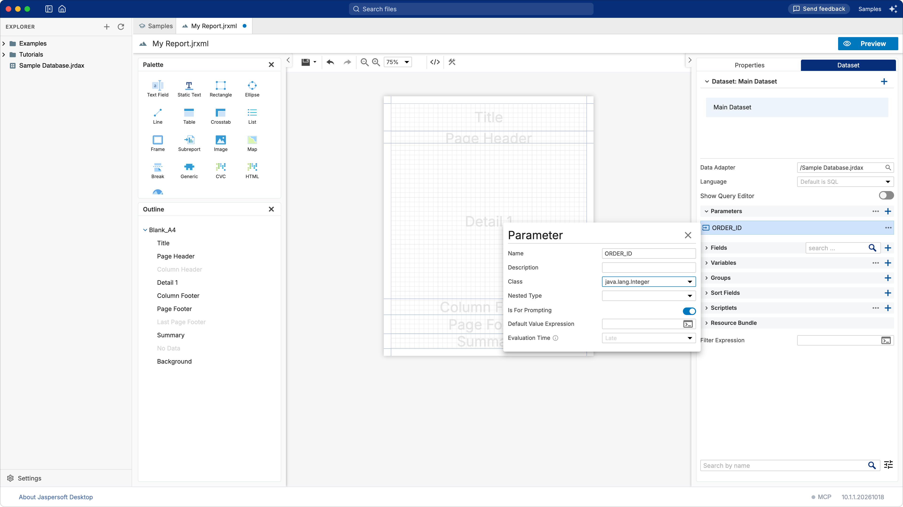
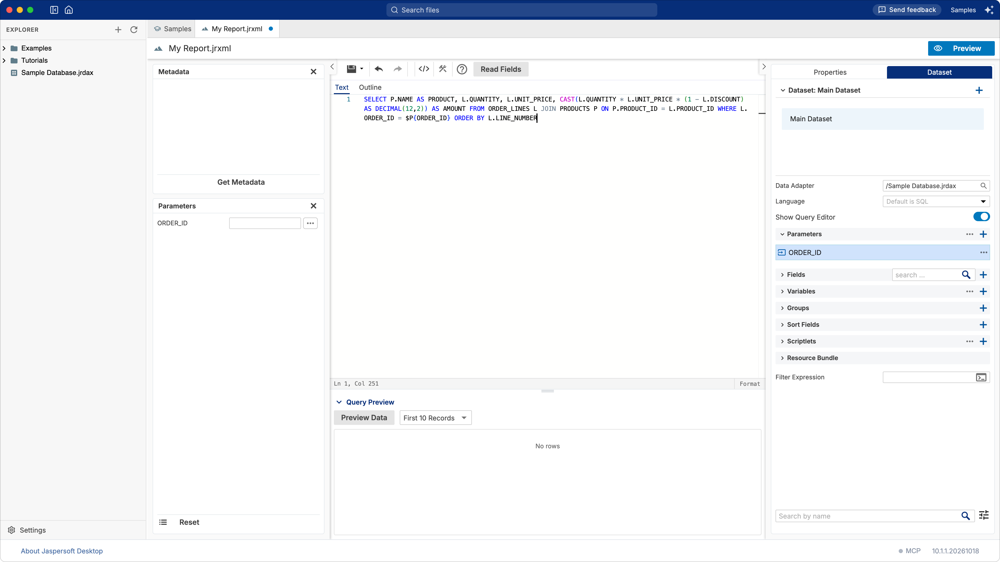
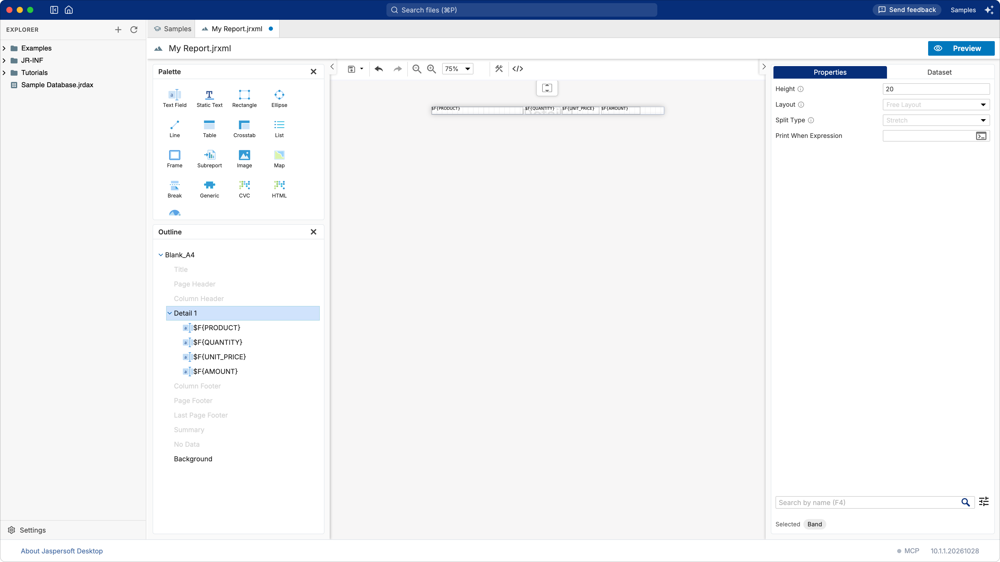
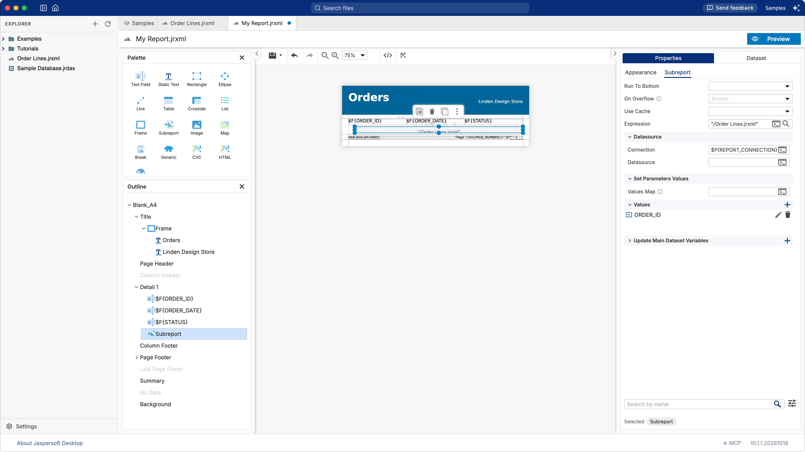

# Tutorial: orders and their lines, with a subreport

**What you build:** the orders of a customer in the last quarter of 2025, each followed by its
lines: the products, the quantities, the prices. **What you learn:** a subreport, a report that
takes a parameter and runs inside another one, and how the two are linked. **Time:** about 25
minutes.



## Before you start

You work in the **Samples** workspace, on the sample database (see
[A chart and a table](tutorial-chart-table.md#before-you-start)). You build two reports:

- `Order Lines.jrxml`, the **subreport**: the lines of one order, the one it is given;
- `Orders of a Customer.jrxml`, the **master**: the orders, and for each of them, the subreport.

[How a report works](concepts.md#subreports) explains what links the two in a few lines.

## 1. The subreport: the lines of an order

1. Choose **Report** in the explorer's **+** menu. Choose **Blank A4**, then **Next**.
2. In **Data Source**, type `/Sample Database.jrdax`, and the query of the lines of one order,
    12441, to try it:

    ```sql
    SELECT P.NAME AS PRODUCT, L.QUANTITY, L.UNIT_PRICE,
           CAST(L.QUANTITY * L.UNIT_PRICE * (1 - L.DISCOUNT) AS DECIMAL(12,2)) AS AMOUNT
    FROM ORDER_LINES L JOIN PRODUCTS P ON P.PRODUCT_ID = L.PRODUCT_ID
    WHERE L.ORDER_ID = 12441
    ORDER BY L.LINE_NUMBER
    ```

    

3. Click **Next**, double-click the four fields, then **Finish**. A blank template places nothing
    on the page: the fields are in the report, ready to be used.

## 2. The parameter

The subreport must show the lines of the order the master gives it, not of 12441. That order comes
in through a **parameter**.

1. Open the **Dataset** tab, expand **Parameters** and click its **+**. Right-click the new
    `Parameter` and choose **Edit**: set **Name** to `ORDER_ID` and **Class** to
    `java.lang.Integer`, the type of the column. Close it with its **×**.

    

2. Turn on **Show Query Editor** and replace `12441` with the parameter:

    ```sql
    WHERE L.ORDER_ID = $P{ORDER_ID}
    ```

    

    Turn **Show Query Editor** off.

The query names the parameter only once it exists: a query naming a parameter the report does not
have is refused, which is why it was tried on one order first.

## 3. Only the lines

A subreport prints all of its bands, its title and page footer included, wherever the master puts
it. This one needs only the lines.

1. In the **Outline**, point at **Title** and click its **×** (**Delete Band**). Do the same for
    **Page Header**, **Column Footer**, **Page Footer** and **Summary**: only **Detail 1** is left.
2. Click an empty area of the page, open **Properties**, expand **Page Format** and set the four
    **Margins** (**Top**, **Bottom**, **Left**, **Right**) to `0`. The master decides where the
    lines go; margins would add space around each of them.
3. In the **Dataset** tab, expand **Fields** and drag each field onto the **Detail 1** band. Place
    them side by side, on the **Appearance** tab of **Properties**:

    | Field | Position X | Width |
    | --- | --- | --- |
    | `PRODUCT` | `0` | `235` |
    | `QUANTITY` | `240` | `90` |
    | `UNIT_PRICE` | `335` | `95` |
    | `AMOUNT` | `435` | `100` |

   each with **Position Y** `0` and **Height** `20`.
4. Select **Detail 1** in the **Outline** and set its **Height** to `20`: one line per order line.



Save it as `Order Lines.jrxml`, at the top of the workspace.

## 4. The master: the orders

1. Choose **Report** in the **+** menu again, with the template **Simple Blue**, the data adapter
   `/Sample Database.jrdax` and the query:

    ```sql
    SELECT O.ORDER_ID, O.ORDER_DATE, O.STATUS
    FROM ORDERS O JOIN CUSTOMERS C ON C.CUSTOMER_ID = O.CUSTOMER_ID
    WHERE C.COMPANY_NAME = 'Linden Design Store SARL'
      AND O.ORDER_DATE >= DATE '2025-10-01'
    ORDER BY O.ORDER_DATE
    ```

   Choose the three fields, then **Finish**.
2. Set the template's two texts: **TITLE** to `Orders` and **Add a description here** to
    `Linden Design Store` (click each, then **Text** on the **Static Text** tab of **Properties**).
3. Select `$F{ORDER_DATE}` and, on its **Text Field** tab, set **Pattern** to `d MMM yyyy`: the date
    without the time.
4. Select **Detail 1** in the **Outline** and set its **Height** to `50`, to make room under each
    order.

## 5. The subreport in the master

1. Drag `Order Lines.jrxml` from the explorer onto the **Detail 1** band. Jaspersoft Desktop makes a
    **Subreport** element of it, its **Expression** already `"/Order Lines.jrxml"`.
2. With the subreport selected, on the **Appearance** tab: **Position X** `20`, **Position Y** `25`,
    **Width** `535`, **Height** `20`. It grows with the lines it prints.
3. On the **Subreport** tab:
    - under **Datasource**, set **Connection** to `$P{REPORT_CONNECTION}`: the subreport runs its
        query on the database of the master;
    - under **Set Parameters Values**, click the **+** of **Values**, then the pencil of the new
        row: **Name** `ORDER_ID`, **Expression** `$F{ORDER_ID}`. Each time the subreport prints, it
        gets the order of the record being printed.

    

Save the report as `Orders of a Customer.jrxml`, then click **Preview**: each order, followed by
its lines. The first, 12441 of 3 October, has 30 small ceramic vases and 160 garden trowels.

## Going further

- **Labels over the lines.** Give the subreport a **Column Header** band again, with a **Static
    Text** over each column: it prints once above the lines of each order.
- **The total of an order.** A variable in the subreport, the **Sum** of `$F{AMOUNT}`, in a
    **Summary** band; or brought back to the master with **Update Main Dataset Variables**.
- **Another customer.** A parameter in the master in place of `'Linden Design Store SARL'`, as in
    [A filter with parameters](tutorial-parameters.md), used in the query as `$P{Customer}`.
- **In an application.** The expression names the `.jrxml`, which Jaspersoft Desktop compiles when
    it runs the report. An application that ships compiled reports names the `.jasper` instead:
    `"Order Lines.jasper"` (see [Getting the .jasper file](concepts.md#getting-the-jasper-file)).

## What you learned

- A **subreport** is a report of its own, run by a **Subreport** element of the master, once each
    time its band prints.
- It receives values through its **parameters**: the master sets them in **Set Parameters
    Values**, here the order being printed.
- **Connection** `$P{REPORT_CONNECTION}` gives it the master's database.
- A subreport needs only the bands it prints, and no margins.
