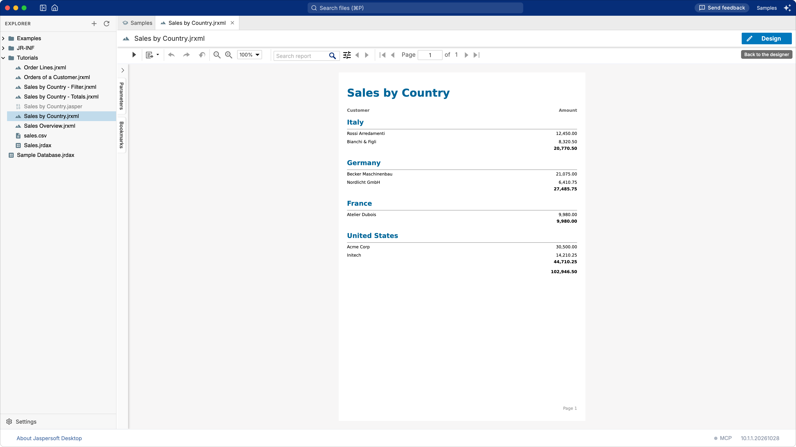
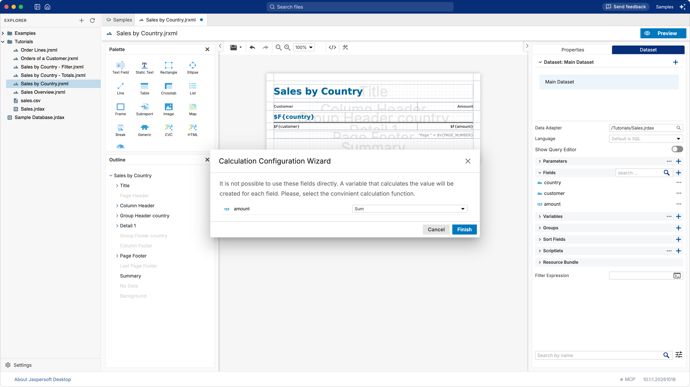
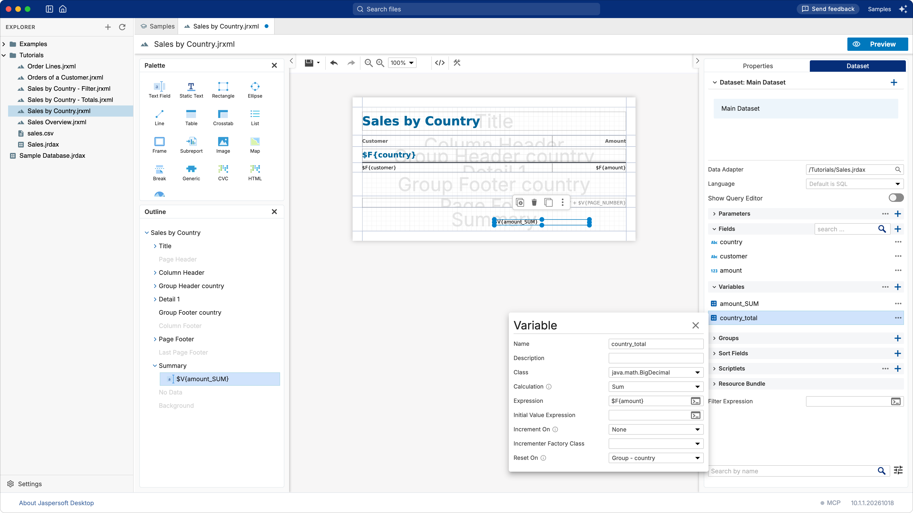
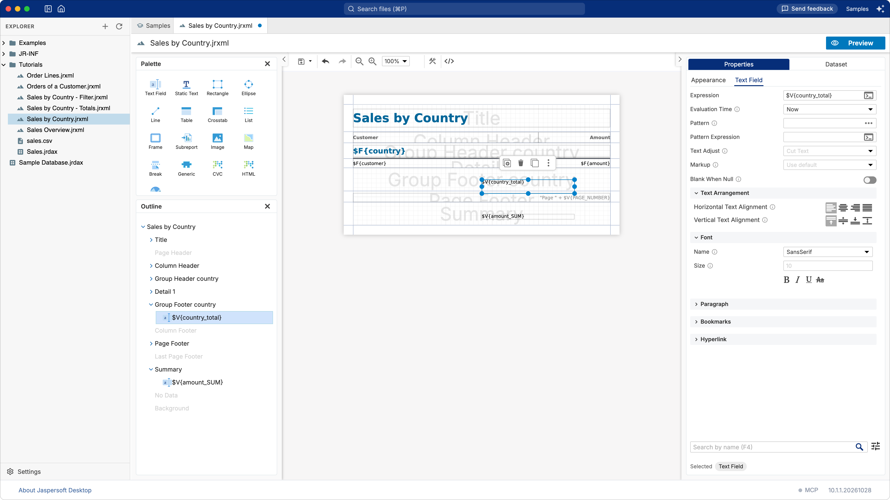

# Tutorial: totals and grouping

**What you build:** the sales report grouped by country gets a total for each country and a grand
total at the end. **What you learn:** bands that are not in the report yet, variables, how a total
starts again at each group, and placing an element precisely. **Time:** about 15 minutes.

## Before you start

You work in the **Samples** workspace, which comes with Jaspersoft Desktop. On the home screen,
click **Samples and tutorials**. The first time, Jaspersoft Desktop copies the samples into your
Documents folder, `Documents/Jaspersoft Desktop/Samples`, and opens them; the copy is yours to
change. In the explorer, open the **Tutorials** folder, then `Sales by Country.jrxml`: the report,
grouped by country. It reads `sales.csv` through its data adapter, `Sales.jrdax`, both in the same
folder.

Click **Preview** if you want to see the report as it is: a section for each country, with its
customers and amounts.

If some of the words below are new to you (bands, fields, variables, groups), read
[How a report works](concepts.md) first: it takes five minutes.

## 1. The grand total

A grand total is printed once, at the end of the report: its place is the **Summary** band.

1. In the **Outline**, on the left, **Summary** is grey: the report has no summary band yet. Point
    at it and click the **+** (**Create Band**) at the end of its row. The band appears on the page.
2. Open the **Dataset** tab, at the right of **Properties**, and expand **Fields**.
3. Drag the field **amount** onto the **Summary** band, on the page.

Jaspersoft Desktop knows that the amount of one record means nothing in the summary, so it asks
what to compute with it, in the **Calculation Configuration Wizard**. Choose **Sum**, then click
**Finish**.

This creates two things: a **variable**, `amount_SUM`, that adds up the amounts as the report
goes, and a **text field** in the summary band that shows it, `$V{amount_SUM}`. You find the
variable in **Variables**, in the **Dataset** tab.

## 2. A total for each country

The total of a country goes at the end of the country's section: in the **Group Footer
country** band.

1. In the **Outline**, point at **Group Footer country** (grey) and click its **+**.

    Now the total. You could drag **amount** onto the group footer as before, but a variable made by
    the wizard adds up **from the beginning of the report** (its **Reset On** is **Report**): in the
    footer of the second country it would show the total of the first two. A total for each country
    must start again at each country. So this time you create the variable yourself:

2. In the **Dataset** tab, expand **Variables** and click its **+**. A variable named `Variable`
    is added.
3. Right-click it and choose **Edit**. In the editor that opens, set:

    | Property | Value | Why |
    | --- | --- | --- |
    | **Name** | `country_total` | The name you will use in the report. |
    | **Class** | `java.math.BigDecimal` | The kind of value: the amounts are decimal numbers. |
    | **Calculation** | **Sum** | Add up… |
    | **Expression** | `$F{amount}` | …the amount of each record. |
    | **Reset On** | **Group - country** | Start again from zero at each country. |

    

    Changes apply as you make them: close the editor with its **×**.

4. From the **Palette**, drag a **Text Field** onto the **Group Footer country** band.
5. With the new text field selected, open **Properties**, then its **Text Field** tab. In
    **Expression**, replace `"Text Field"` with `$V{country_total}`.

    

## 3. Put the totals in their place

The two totals should sit under the **Amount** column, formatted as the amounts are. For each of
them (select it on the page, or in the **Outline**):

1. On the **Appearance** tab of **Properties**: **Position X** `400`, **Position Y** `0`, **Width**
    `155`, **Height** `20`: the place and the size of the **Amount** column.
2. On the **Text Field** tab:
    - **Pattern** `#,##0.00`, the format of the amounts above;
    - under **Text Arrangement**, **Horizontal Text Alignment**: right;
    - under **Font**, **Bold**.

An element must fit inside its band. If one reaches below the bottom of its band (dropped too low,
or too tall), the preview refuses the report with "Element bottom reaches outside band area":
move it up, or make it shorter.

Finally, select **Group Footer country** in the **Outline** and set its **Height** to `24`, so that
the band is not taller than its total.

## 4. Preview

Click **Preview**. Under each country you see its total (Italy: 20,770.50), and the grand total at
the end: 102,946.50. Save the report: **⌘S** (**Ctrl+S** on Windows and Linux), or the save button
of the toolbar.

## What you learned

- A band that is grey in the **Outline** is not in the report yet: **+** creates it.
- Dropping a field outside the detail band asks what to compute, and creates a **variable**.
- A variable's **Reset On** decides where its count starts again: **Report** for a grand total,
    a **group** for a subtotal.
- **Properties** places an element exactly, and formats what it shows.

## Starting again from the samples

Jaspersoft Desktop never overwrites your copy of the samples. To get the original files back,
close the workspace, then delete or rename the `Samples` folder in `Documents/Jaspersoft Desktop`;
the next click on **Samples and tutorials** copies them again.

Next: [A filter with parameters](tutorial-parameters.md).
