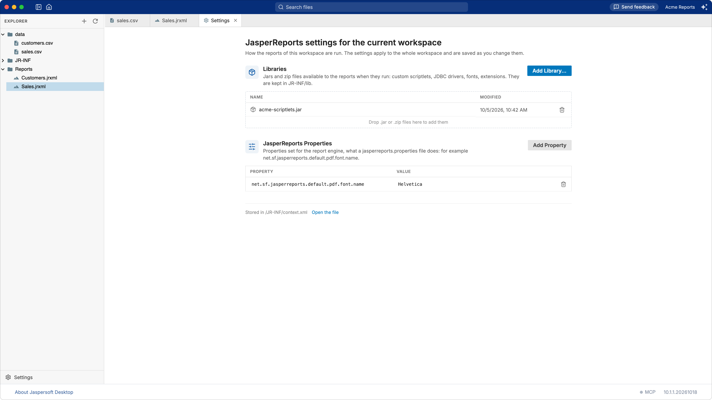

# Workspace settings

The settings of a workspace say how its reports are run: the libraries they need (JDBC drivers,
scriptlets, fonts, extensions of JasperReports) and the properties of the report engine. They
apply to every report of the workspace, in the designer, in the preview and for the AI assistant.

To open them, click **Settings** at the bottom of the explorer. They open in a tab of their own.

There is no Save button: each change is saved as you make it.

A workspace on a JasperReports Server has no settings here: its reports run with what the server's
administrator installed on it.

## Libraries

**Libraries** are the `.jar` and `.zip` files the reports need when they run, for example:

- a **JDBC driver**, for a data adapter connecting to a database (see
  [Working with data adapters](data-adapters.md));
- **custom code** used by the reports: scriptlets, functions, data sources;
- **fonts** packaged as a JasperReports font extension;
- other **extensions** of JasperReports, such as custom components.

To add one, click **Add Library…** and choose the file, or drag the files onto the list. Only
`.jar` and `.zip` files are accepted. A library with the name of one already there replaces it,
after asking.

Libraries are copied into the workspace, in its `JR-INF/lib` folder, so the workspace carries what
its reports need: share the folder, and the reports run the same on another computer. To remove a
library, click the remove button on its row: the reports using it will no longer find it.

## JasperReports properties

**JasperReports Properties** are settings of the report engine, the ones a
`jasperreports.properties` file sets. For example:

| Property | What it does |
| --- | --- |
| `net.sf.jasperreports.default.pdf.font.name` | The font PDF exports use when a report names none |
| `net.sf.jasperreports.export.pdf.force.linebreak.policy` | Breaks lines in PDF exports as the screen does |
| `net.sf.jasperreports.awt.ignore.missing.font` | Lets reports run when a font they name is not installed |

The JasperReports documentation lists them all, under "Configuration Reference".

Click **Add Property**, type the name of the property and its value. The row is saved when you
press Enter or leave it. **Remove** takes a property away.

## Where the settings are kept

In the workspace itself, in `JR-INF/context.xml` (the link at the bottom of the page opens it).
`JR-INF`, its `lib` folder and `context.xml` are created the first time you add something.

`context.xml` is a plain XML file that you can keep in version control with the rest of the
workspace. If you change it with another tool, the page reads it again when you come back to it.
If the file cannot be understood, the page says so and lets you change nothing until it is fixed
or removed.
