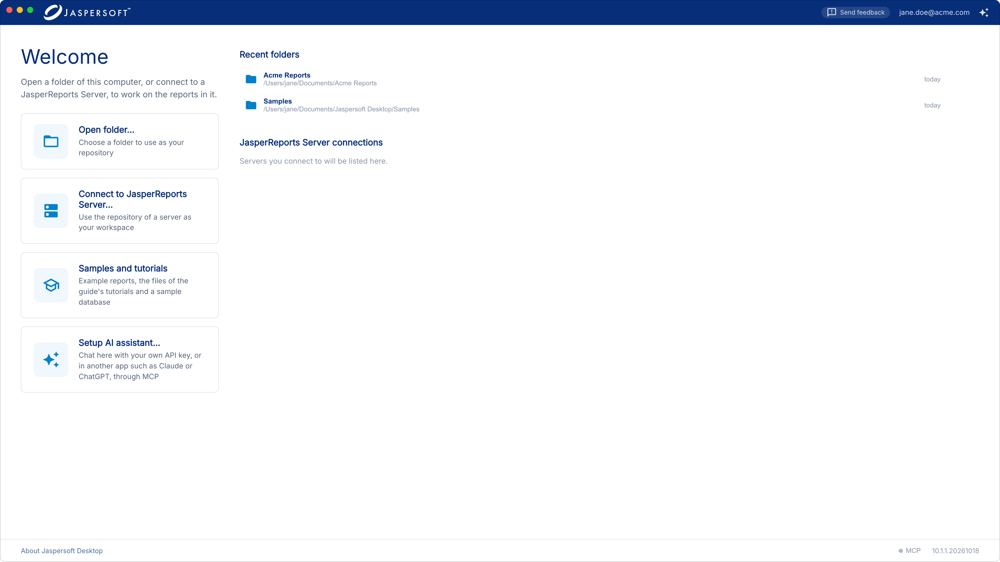
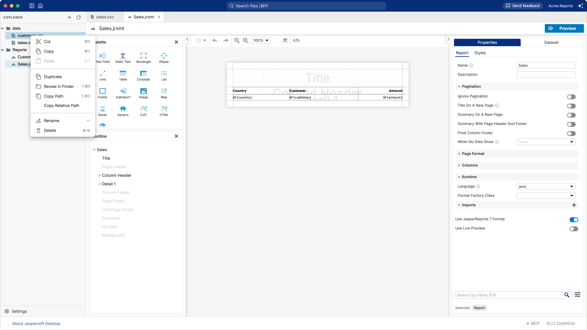
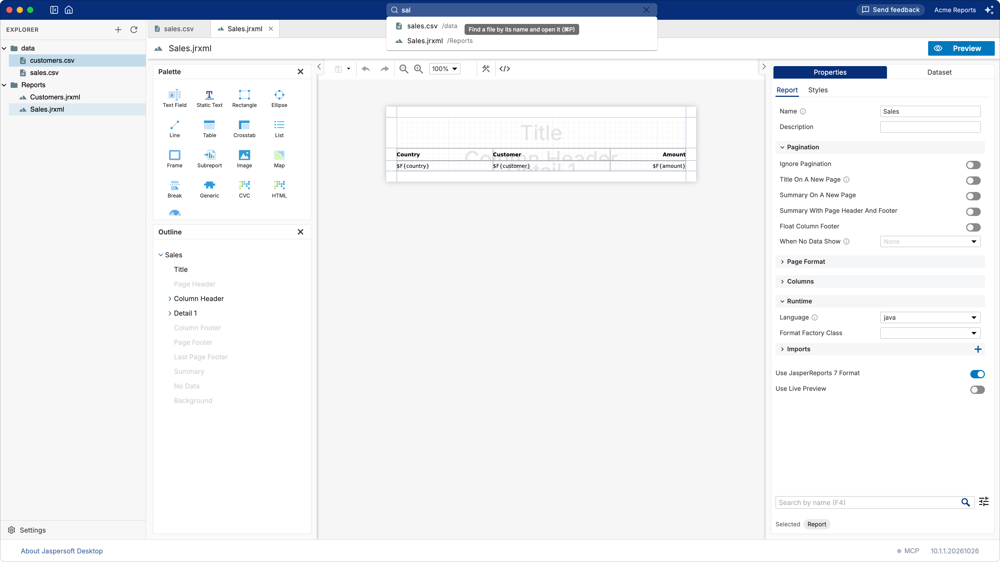
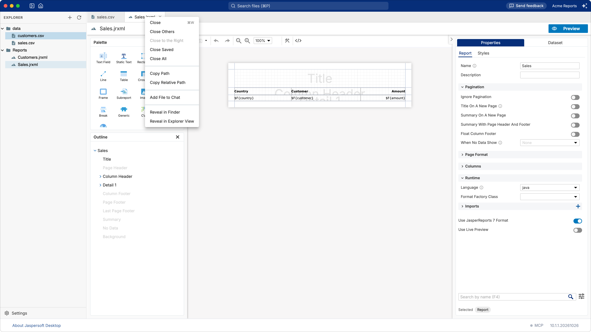
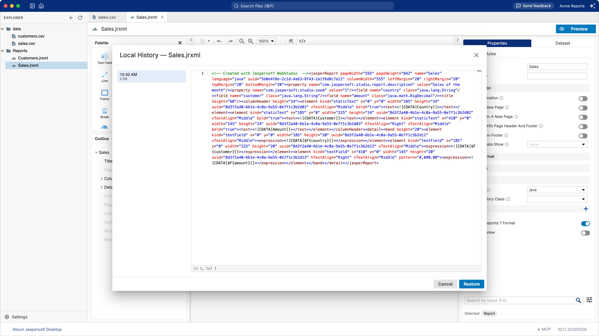

# Working with workspaces

In Jaspersoft Desktop you always work in a **workspace**: a folder of your computer, with your
reports, data files and data adapters in it, or the repository of a JasperReports Server. This
chapter is about folders: opening one, finding your way in it, and keeping your work safe.

A workspace folder is an ordinary folder. Jaspersoft Desktop keeps nothing of its own in it except
what you create, and the `JR-INF` folder of the [workspace settings](workspace-settings.md) once you
use them. You can keep it in a version control system such as Git, share it, or open it with other
tools at the same time.

## Opening a folder

On the home screen, click **Open folder…** and choose the folder. You can create a new, empty
folder from the same dialog.

The folders and the JasperReports Server connections you opened before are listed on the right,
the latest first, with when you last opened them. Click one to open it again. To take one off the
list, point at it and click **Remove from the list**: the folder itself is not touched.

You can also open a folder from a terminal, by starting Jaspersoft Desktop with the path of the
folder. If Jaspersoft Desktop is already running, the folder opens in it: only one copy of the
application runs at a time.

To go back to the home screen, click **Home** in the title bar.
When you open the folder again, it comes back as you left it: the same documents open, the same
document on show, the same folders expanded.

## The workspace window

| Part | What it is for |
| --- | --- |
| **Title bar** | **Show Explorer** / **Hide Explorer**, **Home**, the **Search files** box, and at the right the **AI Assistant** button (see [Designing reports with AI](ai-assistant.md)). |
| **Explorer** | The files and folders of the workspace. Drag its right edge to make it wider. |
| **Tabs** | One for each open document. |
| **Editor** | The document of the active tab: the report designer for a report, a form for a data adapter, a text editor for CSV, JSON, XML, properties and the like. |
| **The bar at the bottom** | **About Jaspersoft Desktop** — the version, the license and the update state, the same as on the home screen (see [Updates](installation.md#updates) and [The About dialog](activation-and-licensing.md#the-about-dialog)) —, and the **MCP** dot of the AI assistant. |

The explorer can be put away — **Hide Explorer** in the title bar — to give the open document more
room. A workspace that opens with nothing in it shows the explorer even so, whatever was chosen
last: opening a document is what it is for. From there it is yours to put away as you like.

## The explorer

Folders are listed first, then files, by name. **Click a file to open it** in a tab, or to switch to
its tab if it is already open. Click a folder to expand or collapse it.

The **+** button at the top of the explorer creates something new in the workspace: a report, a
book, a data adapter, a folder. **Import File** and **Import Folder** copy files from elsewhere on
your computer into the workspace. You can also drag files from Finder or File Explorer onto a folder
of the explorer.

Right-click a file or a folder for more:

| Command | What it does |
| --- | --- |
| **New ›** | A new report, book or data adapter in that folder (on a folder). |
| **New Folder**, **Import File**, **Import Folder** | As in the **+** menu, in that folder. |
| **Cut**, **Copy**, **Paste** | Moves or copies files and folders into another folder: cut or copy them, then paste on the folder (or on a file in it). |
| **Duplicate** | A copy next to the original. |
| **Reveal in Finder** (macOS), **Reveal in File Explorer** (Windows), **Open Containing Folder** (Linux) | Shows the file in the file manager of your system. |
| **Copy Path**, **Copy Relative Path** | The path of the file on your computer, or within the workspace (`/data/sales.csv`). |
| **Rename** | A new name, in the same folder. |
| **Delete** | Deletes the file or the folder, everything in it included, after asking. It does not go to the trash. |
| **Refresh** | Reads the folder again (on a folder). |

To **move** files, drag them onto another folder, or cut and paste them. To work on several at
once, select them with **⌘** or **Ctrl**+click and **Shift**+click: you can then cut or copy them,
copy their paths, delete them, or drag them together.

Files and folders copied in Finder or File Explorer can be pasted into the explorer too: click the
folder and press **⌘V** (macOS) or **Ctrl+V** (Windows, Linux).

When something with the same name is already in the folder, you are asked what to do: **Replace**
it, **Keep Both** (the copy gets a number, `sales 1.jrxml`) or **Skip** it. Tick the box to give
the same answer for the other files of that paste. A folder is never replaced this way.

The menu shows the keyboard shortcut of each command. They work when the explorer has the focus
(click in it first):

| Command | macOS | Windows, Linux |
| --- | --- | --- |
| **Cut**, **Copy**, **Paste** | ⌘X, ⌘C, ⌘V | Ctrl+X, Ctrl+C, Ctrl+V |
| **Copy Path** | ⌥⌘C | Shift+Alt+C |
| **Reveal in Finder**, **Reveal in File Explorer**, **Open Containing Folder** | ⌥⌘R | Shift+Alt+R |
| **Rename** | Return | F2 |
| **Delete** | ⌘Delete | Delete |

New documents, a **Report** or a **Data Adapter** made from the **+** menu, open at once in a tab
named `My Report.jrxml` or `My Data Adapter.jrdax`. Nothing is written to the folder until you save
them; then you can rename them in the explorer.

## Finding a file

Type part of a name in **Search files** at the top of the window. The files of the whole workspace
whose name matches are listed as you type; pick one to open it.

## Tabs

Each open document has a tab. A tab whose document has changes not saved yet shows a dot; point at
it to see the close button instead. Point at a tab to see the path of its document.

Right-click a tab for **Close**, **Close Others**, **Close to the Right**, **Close Saved** and
**Close All**, the paths of the document, **Add File to Chat** (for the AI assistant), and
**Reveal in Explorer View**, which shows the document in the explorer.

Closing a document with unsaved changes asks first. Closing the window, or going back to the home
screen, with unsaved changes asks too.

## Saving, and keeping your work safe

**Jaspersoft Desktop never saves for you.** A document is written to its file only when you save
it: **⌘S** on macOS, **Ctrl+S** on Windows and Linux, or the save button of the report designer's
toolbar. Until then the file on disk is the one you last saved, which is what other tools, Git and
your colleagues see.

What you have not saved is not lost if something goes wrong, though. As you work, Jaspersoft
Desktop keeps copies of your unsaved work in the **local history** of each document, outside the
workspace folder:

- a copy of a report once you stop changing it for a couple of seconds, at most one every minute
  and a half;
- a copy before anything replaces the document on show, such as closing it or reloading it after
  a change made elsewhere;
- up to 60 versions of each document, none older than 30 days.

To go back to one, open the document and choose **File › Local History…**. Pick a version on the
left to see it on the right, then click **Restore**. The version on show before is kept as well,
so a restore can be undone the same way.

### Changes made outside Jaspersoft Desktop

You can change the files of the workspace with other tools while Jaspersoft Desktop is open: an
editor, Git, a script. When you come back to the Jaspersoft Desktop window, it reads the folders
again, and the explorer shows the files as they are now.

## The menu

| Menu | Command | Shortcut (macOS / Windows and Linux) |
| --- | --- | --- |
| **File** | **Local History…** | |
| **View** | **Design**, the report designer | ⌘⇧D / Ctrl+Shift+D |
| | **Edit Source**, the JRXML of the report | ⌘⇧U / Ctrl+Shift+U |
| | **Preview** | ⌘⇧P / Ctrl+Shift+P |
| | **AI Assistant** | ⌘⇧A / Ctrl+Shift+A |
| | **Actual Size**, **Zoom In**, **Zoom Out** of the whole window | ⌘0, ⌘+, ⌘- / Ctrl+0, Ctrl++, Ctrl+- |
| **Help** | **License Agreement**, **Show Logs** | |

On Windows and Linux the window has no menu bar: click the **Menu** button at the left of the title
bar.

**Show Logs** opens the folder of Jaspersoft Desktop's logs, the first thing support asks for when
something goes wrong.

## File types

| File | Opens in |
| --- | --- |
| `.jrxml` reports and `.jrtpl` templates | The report designer |
| `.jrdax` data adapters | The data adapter editor (see [Working with data adapters](data-adapters.md)) |
| `.jrtx` style templates | The style template editor (see [Working with style templates](styles.md)) |
| CSV, JSON, XML, HTML, CSS, JavaScript, properties, text | A text editor |
| PNG, JPEG, GIF, SVG, BMP, WebP images | An image viewer |
| `.jasper` compiled reports | Only their information: they are produced by the engine, not edited |

Other files are listed, but Jaspersoft Desktop has no editor for them.
